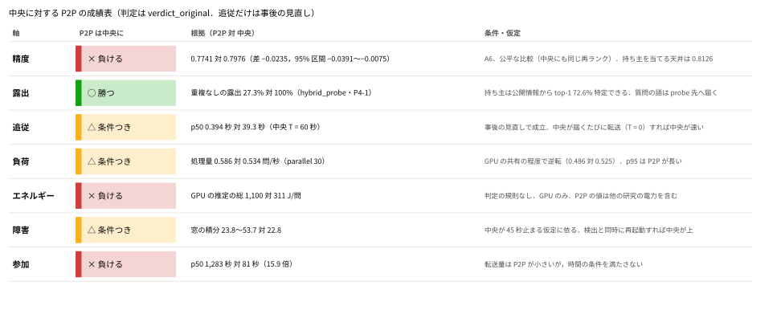
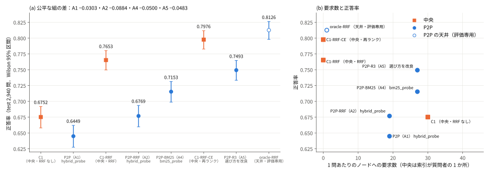
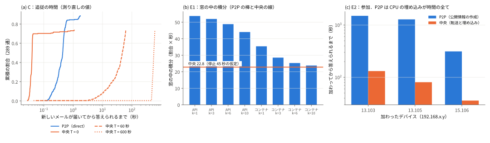
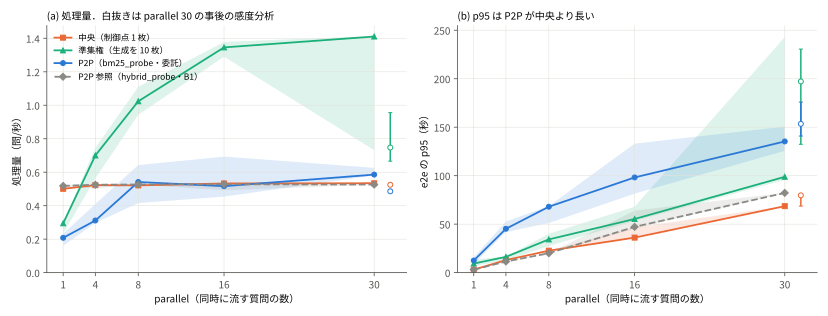

# d0007 最終報告：分散 P2P 型と中央集約型の，31 台の実機での多基準の比較（p0007）

この文書は，p0007（[plans/p0007_p2p_vs_central.md](../plans/p0007_p2p_vs_central.md)）の最終報告である．
EnronQA（150 人の受信箱，73,772 通）を，同じ 31 台の実機の上で，中央集約型・準集権型・分散 P2P 型として動かし，精度・露出・新しいメールへの追従・負荷・障害と参加で比べた．
各実験の条件・判定の規則・数値の全文は [journal](../.claude/research/journal.md) の「p0007 のまとめ」と各節に，実行のディレクトリは [results/README.md](../results/README.md) にある．
研究全体の位置づけは [d0006](d0006_research_overview.md) の §6.7 にある．

## 要約：中央に対する P2P の成績表

P2P は，精度では最終の構成（A6．`bm25_probe`・`owner_answer`・m = 3・RRF で，3 つの候補に通常のプロンプトで答えさせ，cross-encoder で回答を選ぶ規則 R3′），他の軸では各節の構成（§4．負荷は A4 の標準構成）である．中央は全メールを制御点に集めた構成で，精度では P2P と同じ改良を入れた C1-RRF-CE と比べた．
「P2P は中央に」の欄は `verdict_original`（結果を見る前に決めた規則の判定）に基づく．事後の見直しと，仮定への依存は「条件・仮定」の欄に書いた．根拠の全文は §4，判定の表は §5 にある．

| 軸 | P2P は中央に | 根拠の数値（P2P 対 中央） | `verdict_original` | 条件・仮定 |
|---|---|---|---|---|
| 精度（A） | **負ける** | 0.7741 対 0.7976（差 −0.0235，95% 区間 −0.0391〜−0.0075．2,939 問） | 非劣性（δ = 0.02）・優越とも不成立 | 公平な比較（中央にも同じ cross-encoder の再ランク）．A6 はユーザーの承認による反復の上限（5）を超えた 1 回．R3′ の得点は実行の後にオフラインで計算した．持ち主を正しく特定した P2P（oracle-RRF．評価専用）は 0.8126 |
| 露出（B） | **勝つ** | 重複なしの露出 27.3% 対 100%（全 73,772 通） | 成立 | 値は hybrid_probe（P4-1）のもので，A4・A5 の構成（1 問あたり同じ 10.00 通）の重複なしの数は未算出．公開情報から持ち主を top-1 72.6% 特定できる．A4 の構成は質問の語を平文で probe 先の 24 台へ送る（未計上） |
| 追従（C） | **条件つき** | 答えられるまで p50 0.394 秒 対 39.29 秒（中央 T = 60 秒） | 不成立（p50 3.18 秒） | **事後の見直し**（測定の道具の負荷を除いた測り直し）で成立．中央が届くたびに転送（T = 0）すれば中央が 0.040 秒で速い |
| 負荷（D） | **条件つき** | parallel 30 の処理量 0.581〜0.626 対 0.531〜0.537 問/秒 | 成立（L1） | **GPU の共有に依存**：別の研究の GPU の使用が続く時間帯の流し直しでは 0.481〜0.497 対 0.522〜0.535 で逆転．p95 は P2P が長い．準集権（生成を 10 枚へ）は P2P より高い |
| エネルギー（D） | **負ける** | GPU の推定の総 1,100 対 311 J/問 | 判定の規則なし（併記） | GPU だけを測った（CPU は測れない）．P2P の値は別の研究の GPU の電力を含み揺れが大きい |
| 障害（E1） | **条件つき** | 窓の積分 23.8〜53.7 対 22.8（全 8 条件） | 成立 | **中央が復旧の操作を始めるまで 45 秒止まる仮定に依る**（根拠は無い）．中央が検出と同時に再起動すれば，中央が全 8 条件で P2P 以上 |
| 参加（E2） | **負ける** | 答えられるまで p50 1,283 秒 対 80.9 秒（15.9 倍） | 不成立 | 転送量は P2P が小さい（8.26 MB 対 15.63 MB）が，時間の条件（1.25 倍以内）を満たさない |

**結論**：

1. P2P は精度で中央に劣る．中央にも同じ改良を入れた公平な比較で，最終の構成（A6）は −0.0235（95% 区間 −0.0391〜−0.0075，McNemar p = 0.0043）であり，A の 6 回の反復（上限 5 回と，承認された追加の 1 回）で非劣性に届かなかった．A5（−0.0483）からの改善は，UNKNOWN を許すプロンプトをやめたことによる（A5 の P2P に対して +0.0248，p = 1.5e-4）．
2. メールを持ち主のデバイスの外へ集めずに済むこと（露出）は，明確に勝つ（重複なしの露出 27.3%．中央は 73,772 通の全てを集める）．追従は，中央が転送を 60 秒以上の間隔でまとめる場合だけ勝つ（事後に見直した基準）．
3. 負荷と障害は条件つきである（負荷は GPU の共有で逆転し，障害は中央の停止 45 秒の仮定に依る）．エネルギー（GPU のみ．約 3.5 倍）と参加（15.9 倍）は負ける．
4. 持ち主の受信箱だけに問い合わせる oracle-RRF は 0.8126 で，C1-RRF を +0.0473（p = 4e-10）上回り，C1-RRF-CE と同程度である（+0.0150，95% 区間 −0.0007〜+0.0310，p = 0.069）．したがって精度の差は，受信箱ごとの文脈で答える P2P の構成そのものではなく，持ち主の特定と回答の選び方に由来する．A6 の oracle-RRF との差 −0.0388 の内訳は，持ち主の特定 −0.031・回答の選び方 −0.011 で，持ち主の回答を採った問は oracle と同程度（+0.002）になった（A5 で −0.024 だった UNKNOWN を許すプロンプトの分は消えた）．ただし oracle-RRF は持ち主を知っている評価専用の構成で，実際の P2P は持ち主を当てられない．
5. 以上より「P2P は中央より優位」とは結論せず，精度と他の軸の交換関係として報告する（p0007 §7 の「非劣性を満たさない」の行）．

**読み方**：

- 上の成績表と結論が要約である．各軸の判定の表は §5，根拠は §4 の各節にある．
- 数値は journal と `results/` の記録から写した．各表の出どころは，表の下か節の見出しにある実行名で追える．
- 判定は，結果を見る前に journal へ書いた規則（`verdict_original`）を先に書く．結果を見た後で基準を見直したものは `verdict_revised` として並べ，「事後の見直し」と書く（p0007 §4.4）．
- 図は `scripts/tasks/p0007_figure.py` が `results/` の記録から作る（`uv run --with matplotlib python scripts/tasks/p0007_figure.py docs/figures`）．

---

## 1. 背景と問い

多くの組織では，メールや文書が部署や個人の PC に分かれて置かれている．これらを 1 か所に集めると，検索や回答は簡単になるが，集める時点で全データが組織の 1 台に渡る．
集めずに，各 PC が自分のデータと小さな LLM を持ち，質問のたびに問い合わせ先を選ぶのが，本研究の分散 P2P 型である．

p0006 までの結果では，P2P は中央より精度が低かった（C1 0.6752 に対し hybrid_probe 0.6554．差 −0.0198，p = 0.003）．
p0007 の問いは次の 2 つである．

1. 精度の差を詰めたうえで，露出・追従・負荷・障害と参加の複数の軸で，P2P が中央より優位と言えるか．優位の条件は，精度で非劣性（δ = 0.02），かつ B・C・D・E のうち 3 つ以上で優位（p0007 §4.2）．
2. 壁時計の時間で測る動的な性質や，CPU と GPU が混在する既存機材での費用など，シミュレーションでは見えない点を実機で測ると，何が分かるか．

---

## 2. 関連研究と本研究の位置

| 研究 | 評価の形 | 本研究との違い |
|---|---|---|
| RAGRoute（EuroMLSys 2025） | 中央の分類器と中央の LLM | 中央の構成であり，P2P との比較ではない |
| DRAG（arXiv:2505.00443） | 1 プロセスのシミュレーション，公開データ | 実機・私的データ・時間の動的な性質が無い |
| FedRepRAG（arXiv:2609.22162） | 1 枚の GPU の上の模擬 | ルーティング・負荷・時間が無い |
| EnronQA（arXiv:2505.00263） | 中央 RAG のみ | 分散の構成が無い |

調べた範囲では，中央と P2P を同じ実機の上で，生成まで含めて多基準で比べた研究は見つからなかった．
ただし新規性はこの範囲に限る．ルーティングの個々の方式（標本・語の統計・BM25 の probe など）は，選択的検索の既存の資源選択（ReDDE・CORI など）の再実装であり，方式そのものの新規性は主張しない（p0006 の結論）．

---

## 3. 実験系

### 3.1 構成

| 項目 | 内容 |
|---|---|
| 機材 | 質問者・中央・制御点：wafl-ctrl5（RTX 3060 を 1 枚，CPU は i7-8700）．専門家 30 台：GPU の PC 10 台（wafl500〜509．RTX 3060）と CPU のデバイス 20 台（i5-8350U など）．1 台に受信箱 5 個．有線 LAN |
| データ | EnronQA：150 人の受信箱，73,772 通．質問は test 2,940 問・dev 2,948 問（合成の質問．設定の選択は dev，判定は test） |
| モデル | 回答は llama3.1:8b（温度 0），判定は qwen3:8b，埋め込みは arctic-embed-m-v1.5．中央と P2P で同じ |
| 統計 | 差の 95% 区間は対応ありのブートストラップ 10,000 回（種 12），優越は McNemar の正確検定 |

### 3.2 比べる構成

| 構成 | 定義 |
|---|---|
| 中央（C1-RRF） | 全 73,772 通を制御点に集め，1 つの索引（BM25 と密ベクトルの RRF）で上位 5 通を取り，制御点の GPU 1 枚で回答する．ノードには問い合わせない |
| 中央（C1-RRF-CE．A5 の比べる相手） | C1-RRF の上位 50 通を cross-encoder（bge-reranker-v2-m3）で並べ替えた上位 5 通で答える．質問者の LLM は wafl509 で動かした（§7 の 10） |
| 準集権（`semi`） | 索引は中央と同じ．生成だけを GPU の PC 10 台へラウンドロビンで分ける（D の感度分析） |
| P2P の標準構成（A4 で選んだもの．C・D・E で測った） | `bm25_probe`（hybrid_probe の要約で上位 24 台を選び，BM25 と密ベクトルの得点で持ち主の受信箱を 3 つ選ぶ）＋ `owner_answer`（選んだ受信箱ごとに，その受信箱の上位 5 通だけで 8B が答える．m = 3）＋ `abstain`（「答えが無い」を許し，答えた候補のうち密ベクトルの得点が最高のものを採る．規則 R0）＋ 受信箱の中の RRF |
| P2P-A5 | 標準構成と同じ実行で 3 つの候補の回答を全て保存し，回答を選ぶ規則だけを R3（質問と候補の文脈の上位 5 通の cross-encoder の関連度の最大）に替えたもの．R3 は実行の後にオフラインで当てはめた |
| P2P-A6（精度の最終の構成） | A5 と同じ候補（`bm25_probe`・m = 3・RRF）に，通常のプロンプト（UNKNOWN を許さない．B1・oracle-RRF と同じ答え方）で答えさせ，UNKNOWN による除外なしに R3′（R3 と同じ特徴量）で選んだもの．実機は `aggregate: max_score` で流し，R3′ は実行の後にオフラインで当てはめた |
| P2P の天井（oracle-RRF．評価専用） | 持ち主の受信箱 1 つだけに問い合わせ，通常のプロンプト（UNKNOWN を許さない）で答える．実際の P2P は持ち主を知らないので使えない |
| P2P の参照 | hybrid_probe（D = 16）＋ B1（質問者が上位 5 通で答える） |

### 3.3 公平性の原則と判定の記録

- P2P のデバイス内の検索を改良したら，中央にも同じ改良を入れた条件（C1-RRF．A5 では C1-RRF-CE）を並べ，その差で判定する．「P2P だけが改良を使った」比較（P2P-RRF 対 C1，差 +0.0017．P2P-R3 対 C1-RRF，差 −0.0160．P2P-R3′ 対 C1-RRF，差 +0.0088）は，判定と優位の主張に使わない．
- 判定の規則は，各実験の前に journal へ書いて push してから実行した（事前登録）．結果を見た後の見直しは，`verdict_original` を残し，`verdict_revised` として別に出した．該当したのは C の 1 件だけである．
- 退行ゲート R3〜R5（オフラインの再計算・既存の点・Router の選択の全問一致）は，ルーターや質問者・ノードの経路に触れる変更のたびに通した．いずれも通過した．

---

## 4. 結果

### 4.1 A 精度

A1〜A5 の 5 回の反復（上限）と，ユーザーの承認（2026-10-22．backlog B69）による追加の 1 回（A6）で P2P の構成を改良し，その都度，中央にも同じ改良を入れた条件と比べた．A3 は持ち主の特定のオフラインのゲートで，test での比較は無い．test 2,940 問・各 1 回．A5・A6 は dev の全 2,948 問で回答を選ぶ規則を 7 つの候補から 1 つ選び（A5 は R3．dev 0.7581．A6 は R3′．dev 0.7778），test に 1 回だけ当てはめた．A6 の test は 1 問が失敗し（ReadTimeout），`atrium compare` は失敗した問を両方から除くので，A6 の比較は 2,939 問である．

| 回 | P2P の構成 | 比べる相手 | P2P の正答率 | 相手の正答率 | 差（95% 区間） | McNemar p（P2P のみ正解 対 相手のみ正解） | 判定（`verdict_original`） |
|---|---|---|---|---|---|---|---|
| A1 | hybrid_probe・owner_answer（RRF なし） | C1 | 0.6449 | 0.6752 | −0.0303（−0.0456〜−0.0146） | 1.5e-4（226 対 315） | 非劣性・優越とも不成立 |
| A2 | P2P-RRF（hybrid_probe・受信箱の中の RRF） | C1-RRF | 0.6769 | 0.7653 | −0.0884（−0.1054〜−0.0714） | 3.2e-24（204 対 464） | 非劣性・優越とも不成立 |
| A3 | 持ち主の特定に BM25 を使う（オフラインのゲート） | － | － | － | hit@3 0.8391 → 0.9364 | － | ゲート通過（test の比較なし） |
| A4 | P2P-BM25（bm25_probe．C・D・E の標準構成） | C1-RRF | 0.7153 | 0.7653 | −0.0500（−0.0667〜−0.0337） | 5.0e-9（241 対 388） | 非劣性・優越とも不成立 |
| A5 | P2P-R3（A4 ＋ cross-encoder で回答を選ぶ） | C1-RRF-CE | 0.7493 | 0.7976 | −0.0483（−0.0650〜−0.0323） | 2.0e-8（247 対 389） | 非劣性・優越とも不成立 |
| A5（参考．公平でない） | P2P-R3 | C1-RRF | 0.7493 | 0.7653 | −0.0160（−0.0320〜0.0000） | 0.052（257 対 304） | 判定に使わない（P2P だけが cross-encoder を使う） |
| **A6** | **P2P-R3′（A5 の候補を通常のプロンプトで答えさせ，R3′ で選ぶ）．最終の構成** | **C1-RRF-CE** | **0.7741** | **0.7976** | **−0.0235（−0.0391〜−0.0075）** | 0.0043（249 対 318） | **非劣性・優越とも不成立** |
| A6（参考．公平でない） | P2P-R3′ | C1-RRF | 0.7741 | 0.7652 | +0.0088（−0.0058〜+0.0235） | 0.26（258 対 232） | 判定に使わない（P2P だけが cross-encoder を使う） |

全て `verdict_original` で，`verdict_revised` は無い．公平な比較は全て区間の下端が −0.02 を下回る．基準の見直しは行っていない（「目標に届かなかった」は見直しの理由にできない．§4.4 の 2）．A5 の参考の比較も，区間の下端（−0.0320）が −0.02 を下回る．A6 の参考の比較（対 C1-RRF）は下端が −0.0058 で −0.02 を上回るが，P2P だけが cross-encoder を使う比較なので，非劣性の主張には使わない（§3.3）．A6 の 0.7741 は 2,939 問の値で，失敗した 1 問を不正解として全 2,940 問で数えると 0.7738（`results/p0007_a6_test_select/select_eval.json`）．

**改良の効果と天井**（記述．判定に使わない．全て test 2,940 問の対応ありの比較）

| 比べた組 | 差（95% 区間） | McNemar p | 読み方 |
|---|---|---|---|
| P2P-RRF − P2P（A1） | +0.0320（+0.0184〜+0.0456） | 4.4e-6 | RRF の P2P への効果 |
| C1-RRF − C1 | +0.0901（+0.0741〜+0.1061） | 6.4e-28 | RRF の中央への効果 |
| P2P-BM25（A4）− P2P-RRF（A2） | +0.0384（+0.0255〜+0.0514） | 9.0e-9 | 持ち主の特定の改良（A4）の効果 |
| P2P-R3 − P2P-R0（A5 の同じ実行） | +0.0262（+0.0187〜+0.0337） | 4.9e-12 | 回答の選び方の改良（A5）の効果 |
| C1-RRF-CE − C1-RRF | +0.0323（+0.0170〜+0.0476） | 4.6e-5 | cross-encoder の中央への効果 |
| oracle-RRF − C1-RRF | +0.0473（+0.0327〜+0.0616） | 4.0e-10 | 持ち主を完全に当てた P2P の天井 |
| oracle-RRF − C1-RRF-CE | +0.0150（−0.0007〜+0.0310） | 0.069 | 同上（有意でない） |
| P2P-R3 − oracle-RRF | −0.0633（−0.0779〜−0.0493） | 6.2e-18 | 天井までの距離 |
| P2P-R0（A5）− P2P-BM25（A4） | +0.0078（−0.0017〜+0.0173） | 0.13 | 同じ構成の流し直しの揺れ |
| P2P-R3′（A6）− P2P-R3（A5） | +0.0248（+0.0119〜+0.0374） | 1.5e-4 | 通常のプロンプトにした効果（流し直しの揺れを含む．218 対 145） |
| P2P-R3′ − P2P-R0′（A6 の同じ実行） | +0.0953（+0.0834〜+0.1072） | 2.8e-60 | UNKNOWN の除外が無いときの選び方の効果（309 対 29） |
| P2P-R3′ − oracle-RRF | −0.0384（−0.0497〜−0.0272） | 3.5e-11 | 天井までの距離（A5 の −0.0633 から縮んだ） |

- **同じ改良を両側に入れると，中央の方が伸びる**．A2 の RRF は P2P を +0.0320，中央を +0.0901 上げた（中央は 73,772 通から選ぶので，密ベクトルだけの取りこぼしが大きい．Recall@5 0.733）．A5 の cross-encoder は，P2P では回答の選び方を +0.0262 上げ，中央では 50 通の再ランクで +0.0323 上げた．このため，P2P の改良で差は A4 の −0.0500（対 C1-RRF）から A5 の −0.0483（対 C1-RRF-CE）へ，ほとんど動かなかった．A6 の変更（通常のプロンプト）は，中央が初めから使っている答え方に P2P をそろえたもので，中央に入れる改良は無い．A6 で差は −0.0235 に縮んだ．
- **A4 の Router の効果**：持ち主の受信箱が候補 3 つに入る割合は 0.8391 から 0.9320 に上がった．A3 の見込み 0.738 に対し実測は 0.7153 で，新しく候補に入った問が難しかった（入った問の正答率が 0.7775 から 0.7507 に下がった）．
- **A5 の規則の選択**：7 つの規則の順位は dev と test でほぼ同じ（R3 > R4 > R1 > R0・R2 > R5 > R6）．R3 の R0 からの増分は dev +0.0295・test +0.0262．融合得点で選ぶ R1（A4 の後の提案 A4-S1）は test 0.7418 で，R3 より低い．受信箱の中の BM25・RRF（R5・R6）と AvgLogP（R2）は R0 より良くない．
- **A6 の規則の選択**（`results/p0007_a6_{dev,test}_select/select_eval.json`）：UNKNOWN による除外が無いと，持ち主以外の候補も答えるので，検索の得点だけの規則は大きく下がる（test：R0′ 0.6786・R5′ 0.6272・R2′ 0.5895・R6′ 0.5473）．質問と文脈の関連度を見る R3′（0.7738．全 2,940 問）・R4′（0.7578）と，全受信箱を比べる R1′（0.7514）は A5 の同じ規則より上がった．順位は dev と test で同じで，R3′ の dev → test は −0.0040．

**区分ごとの再分解**（test．(a) 持ち主が候補に入らない，(b) 持ち主の回答を採った，(c) 持ち主が候補に入ったが別の回答を採った．寄与 = 割合 ×（P2P − 相手）．`results/p0007_a5_live/a5_report_vs_c1rrf{,_ce}.json`）

| 区分 | R0：割合・正答率 | R3：割合・正答率 | C1-RRF | R3 − C1-RRF の寄与 | C1-RRF-CE | R3 − C1-RRF-CE の寄与 |
|---|---|---|---|---|---|---|
| (a) 持ち主が候補外 | 0.068・0.230 | 0.068・0.250 | 0.430 | −0.0122 | 0.545 | −0.0201 |
| (b) 持ち主の回答を採った | 0.834・0.808 | 0.867・0.808 | 0.797 | +0.0095 | 0.821 | −0.0116 |
| (c) 持ち主が候補内で別の回答を採った | 0.098・0.344 | 0.065・0.490 | 0.693 | −0.0133 | 0.745 | −0.0167 |
| 全体 | 0.7231 | 0.7493 | 0.7653 | −0.0160 | 0.7976 | −0.0483 |

- R3 は (c) を 288 問から 192 問に減らし，(c) の寄与（対 C1-RRF）を R0 の −0.0323 から −0.0133 に縮めた．(a) は選び方では変わらない（持ち主が候補に無い）．
- C1-RRF-CE に対しては (b) でも中央が上である（0.821 対 0.808）．持ち主の回答を採った問でも，中央の再ランクした上位 5 通の文脈は，持ち主の受信箱の RRF の上位 5 通より良い．差は 3 つの区分に分かれ，選び方だけでは埋まらない．

**A6 の区分ごとの再分解**（test 全 2,940 問．失敗した 1 問は (a) に入り不正解．`results/p0007_a6_live/a6_report_vs_{c1_rrf_ce,c1rrf,oracle}.json`）

| 区分 | R0′：割合・正答率 | R3′：割合・正答率 | C1-RRF | R3′ − C1-RRF の寄与 | C1-RRF-CE | R3′ − C1-RRF-CE の寄与 | oracle-RRF | R3′ − oracle の寄与 |
|---|---|---|---|---|---|---|---|---|
| (a) 持ち主が候補外 | 0.068・0.199 | 0.068・0.224 | 0.433 | −0.0143 | 0.547 | −0.0221 | 0.672 | −0.0306 |
| (b) 持ち主の回答を採った | 0.756・0.837 | 0.866・0.837 | 0.796 | +0.0357 | 0.821 | +0.0139 | 0.835 | +0.0024 |
| (c) 持ち主が候補内で別の回答を採った | 0.176・0.184 | 0.066・0.510 | 0.706 | −0.0129 | 0.747 | −0.0156 | 0.670 | −0.0105 |
| 全体 | 0.6786 | 0.7738 | 0.7653 | +0.0085 | 0.7976 | −0.0238 | 0.8126 | −0.0388 |

- **(b) の差は消えた**：持ち主の回答を採った問の正答率は 0.837 で，oracle-RRF（0.835）と同程度，C1-RRF-CE（0.821）より高い．A5 の (b) の −0.024（対 oracle）は UNKNOWN を許すプロンプトによるものだった，という見立てと合う（流し直しの揺れは区別できない）．持ち主が候補に入った 2,739 問の持ち主の候補の正答率は 0.825（A5 は 0.797）．
- **残る差は (a) と (c)**：C1-RRF-CE に対して (a) 持ち主の特定 −0.022，(c) 回答の選び方 −0.016．通常のプロンプトでは持ち主以外の候補も答えるので，R0′ の (c) は 517 問（17.6%）に増えたが，R3′ は 194 問（6.6%．A5 の R3 の 192 問と同程度）に抑えた．(c) の持ち主の候補の正答率は R0′ の (c) で 0.774 で，選び方が完全なら取り戻せる分が残る．
- 天井（記述）：候補のどれかが正解 0.799，持ち主が候補にいれば必ず持ち主を採る（いなければ R3′）0.7840．どちらも C1-RRF-CE（0.7976）に届かない．届かない分は (a) の持ち主の特定にある．

**天井と差の内訳**（`results/p0007_a5_live/a5_ceilings.json`・`p0007_a5_verdict_r3_vs_oracle`）．oracle-RRF は，全問で持ち主の受信箱だけに問い合わせ，通常のプロンプトで答えた実機の実行（評価専用）である．

| 量（test） | 値 |
|---|---|
| 今の候補のどれかが正解（選び方が完全なときの上限） | 0.791 |
| 持ち主が候補にいれば必ず持ち主を採る（いなければ R3） | 0.7599 |
| oracle-RRF | 0.8126 |
| 持ち主の候補が UNKNOWN と答える割合・持ち主以外の候補が UNKNOWN と答える割合 | 3.6%・75.4% |

| P2P-R3 と oracle-RRF の差 −0.0633 の内訳（区分は R3 のもの．寄与 = 割合 ×（R3 − oracle）） | 問 | R3 対 oracle | 寄与 | 由来 |
|---|---|---|---|---|
| (a) 持ち主が候補外 | 200 | 0.250 対 0.670 | −0.029 | 持ち主の特定 |
| (b) 持ち主の回答を採った | 2,548 | 0.808 対 0.836 | −0.024 | UNKNOWN を許すプロンプト（流し直しの揺れを含む） |
| (c) 持ち主が候補内で別の回答を採った | 192 | 0.490 対 0.651 | −0.011 | 回答の選び方 |

- 持ち主を完全に当て，通常のプロンプトで答える P2P は，C1-RRF を有意に上回り（+0.0473），C1-RRF-CE と同程度である（+0.0150．有意でない）．受信箱ごとの上位 5 通で答える P2P の構成そのものは，精度の上限を中央より下げていない．
- 一方，今の候補（m = 3・UNKNOWN を許すプロンプト）からは，選び方が完全でも 0.791 で C1-RRF-CE（0.7976）に届かない．上限を下げているのは持ち主の特定と UNKNOWN を許すプロンプトである．UNKNOWN を許すプロンプトは持ち主以外の候補を 75% 黙らせるために入れたもの（A1 の選択）で，持ち主の回答も下げている．(b) の −0.024 は流し直しの揺れを含む（A4 → A5 の同じ構成の揺れは +0.0078）．A6 で通常のプロンプトにすると (b) の差は +0.002 になり，oracle-RRF との差は −0.0633 から −0.0384 に縮んだ（上の A6 の再分解）．
- oracle-RRF の受信箱の中には cross-encoder を入れていない．P2P の受信箱の中にも再ランクを入れた場合の上限は測っていない．

**費用**（1 問あたり．test）

| 条件 | ノードへの要求数 | 生成 | 外に出た文書 | e2e p50 / p95（秒） | 処理量（問/秒） | 備考 |
|---|---|---|---|---|---|---|
| P2P-BM25（A4） | 27（probe 24 ＋ 回答 3） | 3 | 10.00 | 53.5 / 227.3 | － | RRF の BM25 の索引は i5-8350U のノードで RSS +150〜159 MB・起動 +3.8〜4.3 秒，probe 用の索引は +54 MB・+約 3 秒 |
| P2P-A5（R3） | 27 | 3 | 10.00 | 12.5 / 80.6 | 1.055 | R3 の cross-encoder（1 問 15 組）は実行の後に gpu2 の RTX 3090 で計算（約 0.8 GPU 秒/問．実機の経路には載せていない） |
| P2P-A6（R3′） | 27 | 3 | 10.00 | 主の実行 91.3 / 340.7，再開 193.5 / 1,057.1 | － | 他の研究者の学習が GPU の PC を使い，こちらの 8B の一部が CPU に載った（再開では 43〜56%）．主の実行は途中でノードを止めたので処理量は出さない（dev は 0.238）．R3′ の cross-encoder は実行の後に制御点の RTX 3060 で計算（dev 8,844 候補で約 93 分） |
| C1-RRF-CE | 0 | 1 | 0 | 199.3 / 296.5 | 0.141 | 再ランク 1 問 50 組を制御点の RTX 3060 で 7.1 GPU 秒/問．生成は wafl509 |
| C1-RRF | 0 | 1 | 0 | 64.7 / 81.3 | 0.449 | － |
| oracle-RRF | 1 | 1 | 3.30 | 6.0 / 27.5 | 3.35 | 評価専用 |

e2e と処理量は，同じ構成でも実行ごとに大きく変わる（A4 と A5 の P2P は同じ構成で，p50 が 53.5 秒と 12.5 秒）．条件の間の比較には使わない（§6 の K4 の処理量の行）．

出どころ：`results/p0007_a1_test_verdict_c1`・`p0007_a2_verdict_*`・`p0007_a4_verdict_*`・`p0007_a4_live/a4_report.json`・`p0007_a5_verdict*`・`p0007_a5_test_select/select_eval.json`・`p0007_a5_live/`．

### 4.2 B 露出

仮説 H-B：P2P の重複なしの露出が，全メール 73,772 通の 50% 未満．test 2,940 問で外に出た文書の，重複なしの数．

| 条件 | 重複なしの文書 | 割合 | 1 問あたり | 公開情報 | 持ち主の特定 |
|---|---|---|---|---|---|
| 中央（物理的に集める） | 73,772 | 100% | 最初に全て | － | － |
| C1（全受信箱から上位 5 通を取る） | 64,783 | 87.8% | 750 | 0 | － |
| P4-1（hybrid_probe・B1） | 20,174 | 27.3% | 10 | 29.7 MB | top-1 0.726・AUC 0.975 |
| P4-3（hybrid_probe・B4） | 13,177 | 17.9% | 6.55 | 29.7 MB | 同上 |

- **`verdict_original`：H-B 成立**（`verdict_revised` は無し）．ただし事前登録の再構成の妥当性の確認の一部（記録の `top_doc_ids` の包含 ≥ 0.999）が 0.9980 で届かず，規則どおり下限・上限（P4-1 の上限 38.2%・P4-3 の上限 24.9%）で判定した．どちらも 50% 未満で，再構成した値も同じ側にある．欠けた文書は全て上位 5 通の最下位と同点の文書だった．
- **負け・留保**：P2P は公開情報（29.7 MB）から持ち主を top-1 で 72.6% 特定できる（D6 により P2P の構成として認め，併記する）．A4 の構成は，質問の語を平文で probe 先の 24 台へ送るので，質問の露出が増える．この露出は，文書の露出（B）には数えていない．
- **範囲の限定**：B は p0006 の P4-1・P4-3 で算出した．A4 の標準構成（1 問あたり 10.00 通で P4-1 と同じ）の重複なしの数は算出していない．

出どころ：`results/20261019_155617_p0007_b_exposure`．

### 4.3 C 新しいメールへの追従

正解メールの 10%（289 通．種 12）を実験の開始時に索引から外し，0.5 秒間隔で持ち主のデバイスへ届けた．P2P は持ち主のデバイスが CPU で埋め込んで索引へ足す．中央は間隔 T ごとにまとめて転送し，制御点の CPU で埋め込んで足す（T ∈ {0, 60, 600, ∞}）．

判定（事前登録）：P2P の「答えられるまで」の p50 が 1 秒未満で，かつ中央の T ≥ 60 秒より有意に短い（対の符号検定）．比べるメールは 213 通．

| 判定 | 実行 | P2P の p50（p95） | T = 60・600 より有意に短い | 判定 |
|---|---|---|---|---|
| `verdict_original` | 主の実行（`p0007_c_freshness`） | 3.18 秒（8.65 秒） | 成立（p = 1.2e-58・1.6e-62） | **不成立**（p50 が 1 秒以上） |
| `verdict_revised`（事後の見直し） | 測り直し（`p0007_c_freshness_quiet`） | 0.394 秒（1.43 秒） | 成立（p = 1.6e-62） | **成立** |

- **見直しの理由は，結果とは独立の測定の根拠である**．主の実行の P2P の時間は，届いた順に単調に伸びた（先頭 40 通ごとの p50：0.59・1.39・2.48・3.05・4.01・3.87・5.14・7.18 秒）．答えられたメールは全て 1 回目の検索で答えられており，原因は，答えられないメールを 30 秒間，間隔 0 で繰り返し検索する測定の道具が，1 プロセスのノードを占有したことだった．繰り返しの上限を 2 秒にして測り直したところ，先頭 40 通（0.59 秒）から最後（0.43 秒）まで一定になった．判定の規則・メールの集合・中央の条件は変えていない．
- **中央の T = 0（届くたびに転送）は P2P より速い**：p50 は中央 T = 0 が 0.040 秒，P2P が 0.394 秒．p50 が P2P 以下になる中央の最大の T は 0 である．優位は「T を 0 にできず転送を束ねる中央」に対するものに限る．
- **CPU の既存機材で即時の索引は実用的か**：実用的だった（`fusion: none`．密ベクトルの追加のみ）．1 通の埋め込みは p50 0.392 秒（i5-8350U の専門家 0.426 秒，GPU の PC の CPU 0.206 秒），索引への追加は p50 49 マイクロ秒．
- **転送量は T に依らない**：中央の転送は合計で約 0.71 MB．T は時間だけを決める．

| 構成 | p50（秒） | p95（秒） | 答えられなかったメール（289 通中） | 新しいメールの正答率（届いてから 1 秒後） |
|---|---|---|---|---|
| P2P（direct） | 0.394 | 1.43 | 33 | 0.6540 |
| 中央 T = 0 | 0.040 | 0.063 | 76 | 0.6644（P2P との差 p = 0.72） |
| 中央 T = 60 | 39.29 | 59.97 | 76 | 0.1972 |
| 中央 T = 600 | 533.6 | 599.1 | 76 | 0.1869 |
| 中央 T = ∞ | 答えられない | － | 289 | 0.1869 |

出どころ：`results/p0007_c_freshness`・`p0007_c_freshness_quiet`・`p0007_c_freshness_acc`・`p0007_c_verdict`．正答率は 289 問・1 回で，`snippet_return`（B1）の別の実行から読んだ．

### 4.4 D 負荷とエネルギー

parallel 30 で，生成まで含めた処理量の 3 回の範囲が中央（制御点 1 枚）より上で重ならなければ「優位」（L1）．条件は 4 つ，parallel ∈ {1, 4, 8, 16, 30} × 3 回，300 問（parallel 1 は 150 問）．計 63 実行．

| 条件 | parallel 1 | 4 | 8 | 16 | 30（最小〜最大） | p95（parallel 30．秒） |
|---|---|---|---|---|---|---|
| 中央（制御点 1 枚） | 0.501 | 0.523 | 0.521 | 0.533 | 0.534（0.531〜0.537） | 68.6 |
| 準集権（生成を 10 枚） | 0.295 | 0.700 | 1.024 | 1.346 | 1.411（0.732〜1.414） | 98.8 |
| P2P の標準構成（委託） | 0.208 | 0.311 | 0.541 | 0.516 | 0.586（0.581〜0.626） | 135.3 |
| P2P の参照（hybrid_probe・B1） | 0.518 | 0.525 | 0.527 | 0.528 | 0.526（0.526〜0.526） | 82.2 |

処理量は問/秒の 3 回の中央値．

- **`verdict_original`：L1 成立**（`verdict_revised` は無し）．P2P の 0.581〜0.626 が中央の 0.531〜0.537 より上で重ならない（中央値で +10%）．
- **ただし頑健でない**．(1) 実行の途中から，別の研究者の学習が同じ 10 枚の GPU を間欠的に使い始めた（止めずに記録した）．DETR が止まっている時間を狙って parallel 30 を 3 回ずつ流し直した事後の感度分析では，P2P 0.481〜0.497 が中央 0.522〜0.535 より下で重ならず，逆転した．(2) p95 は P2P が中央より長い（125.7〜150.6 秒 対 68.6〜68.7 秒）．e2e の p50 は P2P が短い（29.7 秒 対 54.9 秒）．
- **準集権が P2P より高い（L2）**：parallel 30 で準集権 0.732〜1.414 が P2P 0.581〜0.626 より上で重ならない．中央の索引のまま生成だけを 10 枚に分けた構成が，中央の 2.6 倍・P2P の 2.4 倍だった．P2P の +10% は，生成を委託できる 10 枚の GPU のごく一部しか使えていないことの結果であり，負荷の優位が分散の構造に由来するとは言えない．P2P の主張は「データを集めずに，既存の GPU に生成を分けられる」ことに限る．
- **中央は parallel 1 で飽和**している（0.50 問/秒）．P2P の参照（18 要求・B1）も同じ 0.52〜0.53 で，要求数の増加は処理量を下げない（生成が律速）．
- **エネルギー（K5）**：RAPL は全台で読めず，GPU の消費電力だけを測った（11 台．1 秒ごと）．CPU の専門家 20 台・質問者・ノードの CPU は含まない．1 問あたりの GPU のエネルギー（parallel 30．アイドル電力を差し引いた増分と，推定の総）は次のとおりで，**GPU のエネルギーでは P2P は優位でない**．

| 条件（parallel 30） | 増分（J/問．3 回の中央値） | 推定の総（J/問） |
|---|---|---|
| 中央 | 288 | 311 |
| P2P の参照 | 295 | 319 |
| 準集権 | 308＊ | 416＊ |
| P2P の標準構成 | 840＊ | 1,100＊ |

＊ 別の研究の GPU の電力を含み，揺れが大きい（準集権の増分は 157〜499）．主の指標（11 台の合計）は他の利用者の電力を含むので使えない．質問者の CPU が重い中央は，CPU のエネルギーを数えない分，有利に見える．

出どころ：`results/p0007_d_verdict`・`p0007_d_verdict_clean`・`p0007_d_*`．

### 4.5 E 障害と参加

**E1 障害**．P2P は k 台（k ∈ {1, 3, 6, 10}．種 12）を 45 秒止める．止め方は 2 通りで，availability API（プロセスは生きて 503 を返す）と，コンテナの実際の停止（応答しない）である．中央は索引を持つプロセスを強制終了して再起動し，最初の質問に答えるまでの時間を測る．主の指標は，同じ窓（76.44 秒 = 停止 45 秒 ＋ 中央の再起動 1.44 秒 ＋ 復旧後 30 秒）の中の，答えられた割合の時間積分である．

| 止め方 | k | 平常 | 停止中 | 検出（秒．p50） | P2P の積分 | 中央の積分 |
|---|---|---|---|---|---|---|
| availability | 1 | 0.748 | 0.707 | 0.11 | 53.7 | 22.8 |
| availability | 3 | 0.741 | 0.667 | 0.11 | 52.0 | 22.8 |
| availability | 6 | 0.752 | 0.594 | 0.09 | 48.8 | 22.8 |
| availability | 10 | 0.742 | 0.491 | 0.09 | 44.0 | 22.8 |
| container | 1 | 0.742 | 0.328 | 2.01 | 35.4 | 22.8 |
| container | 3 | 0.750 | 0.135 | 2.01 | 28.6 | 22.8 |
| container | 6 | 0.778 | 0.056 | 2.01 | 25.3 | 22.8 |
| container | 10 | 0.747 | 0.028 | 2.01 | 23.8 | 22.8 |

- **`verdict_original`：E1 成立**（8 条件の全てで P2P > 中央．`verdict_revised` は無し）．ただしこの成立は，中央が障害から復旧の操作を始めるまで 45 秒止まる，という仮定に依る．中央が検出と同時に再起動を始める場合（窓 31.44 秒）は，中央の 22.8 が P2P の 8 条件の全てで P2P 以上になる（availability の k = 1 は 22.4 対 22.8 でほぼ同じ．container の k = 6・10 では P2P が 0.0）．45 秒の根拠は無く，感度は測っていない．示したのは「復旧に 45 秒かかる中央に対し，k 台までの停止なら P2P は割合が下がるだけで止まらない」ことまでである．
- **中央の再起動は 1.44 秒**（索引の読み込み 0.93 秒．73,772 通・396 MB．ページキャッシュが温かい状態）．冗長化（2 台）は見積もりで，切り替えの操作を 0 秒と仮定すると積分は 57.0〜57.3 となり，P2P の全 8 条件を上回る．複製の費用は，保存が 396 MB 増え，更新ごとの転送が 1 回増えることである．
- **container の停止は，オフラインの予測より 0.35〜0.61 低い**．質問者に失敗の検出・除外の仕組みが無く，止まったノードを probe の集合に含む質問が，時間切れ（5 秒）まで待つためである．診断（container だけの再実行．判定に使わない）で，時間内に答えた質問の割合は平常と同じ（k = 1 で 0.719）であり，下がりは時間切れによることを確かめた．時間切れの質問のうち，正解の受信箱が止まった側にあるのは 17〜47% で，残りは，止まったノードを除外できれば答えられた質問である．

**E2 参加**．150 受信箱のうち 15（ホスト 3 台．種 12）を最初は外し，途中で加える．P2P は，デバイスが自分のメールから公開情報を作り（CPU），質問者がメンバー表に載せる．中央は，全メールを転送して埋め込み，索引へ足す．

| ホスト | メール数 | P2P：公開情報の作成（秒） | 中央：答えられるまで（秒） | 公開情報（MB） | 中央の転送（MB） |
|---|---|---|---|---|---|
| 13.103（i5-8350U） | 2,913 | 1,499 | 132 | 2.74 | 6.34 |
| 13.105（i5-8350U） | 2,611 | 1,281 | 81 | 2.69 | 5.05 |
| 15.106（GPU の PC の CPU） | 2,094 | 313 | 36 | 2.83 | 4.23 |

- **`verdict_original`：E2 不成立**（`verdict_revised` は無し）．P2P の答えられるまでの時間は p50 1,283 秒（p95 1,500 秒）で，中央（p50 80.9 秒・p95 131.9 秒）の 15.9 倍．「中央の 1.25 倍以内」の条件を満たさない．転送量は P2P が小さい（8.26 MB 対 15.63 MB）が，同等の時間の条件に当たらない．
- 時間の全てが，デバイスの CPU による本文の埋め込み（99.6%．i5-8350U で 1 通 0.5 秒）である．ノードの起動・索引の読み込みの時間は含まない．
- **露出**：P2P はメールが外に出ない（0 通）．中央は 7,618 通がデバイスの外へ出る．転送量の差は，主にメールそのものが外に出るか，語の統計と重心だけかの違いである．
- 通知の遅れ L_join = 0・10・100 問では，通知前の質問は全て答えられず（L = 100 で 47 問），通知後の hit 率は 0.707・0.706・0.692 だった．

出どころ：`results/p0007_e1_failure`・`p0007_e1_diag_container`・`p0007_e2_join`・`p0007_e_verdict`．

---

## 5. 総合の判定

p0007 §4.2・§7 の規則を機械的に適用した．精度で非劣性が成立しないので，§7 の「非劣性を満たさない」の行に従い，総合の「優位」とは書かない．精度が負けた軸を先に書く．

| 軸 | 仮説 | `verdict_original` | `verdict_revised`（事後の見直し） | 仮定・頑健性 |
|---|---|---|---|---|
| 精度 A1 | P2P − C1 の非劣性 | 不成立（−0.0303．下端 −0.0456） | なし | － |
| 精度 A2 | P2P-RRF − C1-RRF の非劣性 | 不成立（−0.0884．下端 −0.1054） | なし | 中央にも同じ改良を入れると差が広がる |
| 精度 A4 | P2P-BM25 − C1-RRF の非劣性・優越 | 不成立（−0.0500．下端 −0.0667．優越も不成立） | なし | EnronQA は BM25 に有利 |
| 精度 A5 | P2P-R3 − C1-RRF-CE の非劣性・優越 | 不成立（−0.0483．下端 −0.0650．優越も不成立） | なし | A の反復は上限の 5 回に達した．持ち主を完全に当てる天井（oracle-RRF 0.8126）は C1-RRF-CE と同程度（+0.0150，p = 0.069） |
| **精度 A6（最終）** | P2P-R3′ − C1-RRF-CE の非劣性・優越 | **不成立**（−0.0235．下端 −0.0391．p = 0.0043．優越も不成立） | なし | ユーザーの承認による上限を超えた 1 回（B69）．中央は A5 の C1-RRF-CE の実行を再利用．残る差は持ち主の特定（(a) −0.022）と回答の選び方（(c) −0.016） |
| 露出 B | H-B：重複なしの露出が 50% 未満 | 成立（27.3%・17.9%） | なし | 公開情報から持ち主を 72.6% 特定できる．質問の語が平文で probe 先へ届く．A4 の構成の重複なしの数は未算出 |
| 追従 C | p50 < 1 秒かつ T ≥ 60 の中央より有意に短い | **不成立**（p50 3.18 秒） | 成立（p50 0.394 秒） | 中央 T = 0 は P2P より速い．優位は T ≥ 60 の中央に対してだけ．`fusion: none` の追加で測った |
| 負荷 D（L1） | parallel 30 の処理量の範囲が中央より上 | 成立（0.581〜0.626 対 0.531〜0.537） | なし | 別の研究の GPU の使用で逆転（0.481〜0.497）．p95 は P2P が長い．準集権が P2P より高い |
| 負荷 D（エネルギー） | （併記．判定の規則なし） | － | － | GPU のエネルギーは P2P が中央の約 3.5 倍（推定）．優位でない |
| 障害 E1 | 全 8 条件で窓の積分が P2P > 中央 | 成立 | なし | 中央の停止 45 秒の仮定に依る．中央が検出と同時に再起動すれば，中央が P2P の全 8 条件で P2P 以上 |
| 参加 E2 | 時間で中央より短い，または 1.25 倍以内で転送量が小さい | **不成立**（15.9 倍） | なし | 時間は CPU の埋め込みで決まる |

**「B・C・D・E のうち 3 つ以上で優位」の数え方**（精度で非劣性を満たさないので，どの数え方でも総合の「優位」は成立しない．以下は参考の数である）：

| 数え方 | 優位の軸 | 数 | 3 つ以上か |
|---|---|---|---|
| `verdict_original`（E は E1・E2 の両方の成立を要する） | B・D | 2 | 満たさない |
| `verdict_original`（E は E1 だけで数える） | B・D・E | 3 | 満たす |
| `verdict_revised` を反映（C を成立とし，E は E1・E2 の両方を要する） | B・C・D | 3 | 満たす |
| 仮定・頑健性を考慮（C は T ≥ 60 の中央に対する条件つき，D は GPU の共有で逆転，E1 は中央の停止 45 秒の仮定，E2 は劣る） | B | 1（C を条件つきで足しても 2） | 満たさない |

E 軸の数え方は，p0007 §4.2 が E 軸に 2 つの指標（障害時の答えられる割合，新しいデバイスが加わるまでの時間）を挙げ，§6.5 が E1・E2 の判定を別に出すことから，この報告で決めた．**E 軸を優位と数えるには E1・E2 の両方の成立を要する**（backlog B68）．E1 だけで数えると，`verdict_original` でも 3 になる．

**総合の判定の文言**（§7 の「非劣性を満たさない」の行を，実際の結果に合わせて書いた．§7 の雛形にある「それ以外で優れる」は，結果が支持しないので使わない）：

> P2P は，精度で中央（同じ改良を入れた C1-RRF-CE）に約 0.02 劣る（最終の構成 A6 で −0.0235．非劣性の区間の下端 −0.0391）．その代わり，データを集めずに済み（露出），新しいメールを T ≥ 60 秒の中央より速く使える（追従．事後に見直した基準）．負荷と障害は，仮定や GPU の共有の程度で結果が変わり，優位とは言えない．GPU のエネルギーと参加は P2P が劣る．**P2P は中央より優位とは結論しない．精度と他の軸の交換関係として報告する．**

---

## 6. 実機ならではの知見

- **K1：同じ 31 台での多基準の比較**．中央・準集権・P2P を，生成まで含めて，精度・露出・追従・負荷・障害と参加で比べた（§4）．シミュレーションでは，負荷（GPU の共有）・追従（測定の道具の負荷）・障害（時間切れ）の 3 点で，結論が実機でしか確かめられなかった．
- **K2：壁時計の時間で測る動的な性質**．i5-8350U での 1 通の埋め込みは p50 0.426 秒で，新しいメールは P2P で p50 0.394 秒で使える．中央の再起動は 1.44 秒（温かい状態）．コンテナの停止の検出は 2.01 秒（API の停止は 0.1 秒）で，コンテナの停止の間の答えられる割合は平常の 0.74 から 0.33（k = 1）〜0.03（k = 10）に下がる．デバイスの参加は，最も遅い CPU の公開情報の作成で決まり，313〜1,499 秒かかる．
- **K3：CPU と GPU が混在する既存機材での費用**．(i) 追従と参加の時間は CPU の埋め込みが律速（C：1 通 0.39 秒，E2：公開情報の作成の 99.6%）．(ii) 生成を 10 枚の GPU に分けても，処理量は 10 倍にならない（`semi` / `central` の比は parallel 1〜30 で 0.59・1.34・1.96・2.53・2.64）．他の利用者による 1 枚あたりの速度の低下（decode 43 ms/トークン 対 制御点 16 ms/トークン），1 枚に集まる生成の裾，質問者の CPU が上限になる可能性（未検証）を原因の候補として見ている．(iii) RRF のノードの索引は i5-8350U で RSS +150〜159 MB・起動 +3.8〜4.3 秒．
- **K4：オフライン評価と実機の照合**（`sim_vs_live.json`．各段階）．

| 項目 | オフラインの予測 | 実機の値 | 一致 | 見立て |
|---|---|---|---|---|
| Router の選択 | p0006 P4 の `offline_selection.json` | A1：hybrid_probe の上位 2 が実機の上位 3 に含まれる割合 1.0000．A4：300/300 と 2,940/2,940．D：4,050/4,050 と 4,049/4,049 | 一致 | 実機の質問者・ノードは，オフラインの規則と同じ選択をする．実機のノードの BM25（float64）も，オフライン（float32）と同じ選択になった |
| 候補の集合と回答の選択（A5） | `bm25_probe_m3` の候補・融合得点・R0 の当てはめ | 候補の集合 2,940/2,940．融合得点の差の最大 1.30e-5（8,820 候補．float32 の丸め）．R0 の選択は dev・test とも全問一致 | 一致 | 保存した特徴量で規則を当てはめれば，実機の選択を再現できる．R3 の test の値は，R3 を実機の経路に載せた場合の予測として使える（cross-encoder の計算の費用は未測定） |
| 候補の集合と回答の選択（A6） | 同上（R0′ は実機の `max_score`） | 候補の集合 2,939/2,939．融合得点の差の最大 1.30e-5（1e-5 以内 99.9%）．R0′ の選択と正誤は全問一致．R3′ の dev → test は −0.0040 | 一致 | A5 と同じ．A5 の test と候補の集合は全問一致（同じ Router） |
| 同じ構成の流し直し（A4 → A5 の R0） | 温度 0 なので同じ回答 | 候補の集合 100%・採った受信箱 99.05% 一致．**回答の文字列は 76.7% だけ一致**．正答率 0.7153 → 0.7231（+0.0078．p = 0.13） | 選択は一致，生成は **外れ** | 温度 0 でも，GPU の並列の要求の組み方で生成が変わる．同じ構成の流し直しで正答率が +0.0078 動いた（有意でない）ので，この程度の差は改良の効果と区別できない |
| 露出（B） | 受信箱ごとの上位 5 通の再構成 | 件数の一致 1.0000．ID の包含 0.9980（同点を許すと 1.0000） | ほぼ一致 | 差は重複メールの同点の順序 |
| 中央の索引（`central_local`） | C1 の上位 5 通 | 厳密な集合の一致 0.9942．同点を許すと 1.0000 | 同点を許して一致 | 差は重複メールの同点の順序（D9 で切り替え） |
| 処理量（A1） | 要求数の逆数：P4-1 に対して 18/19 = 0.947 | 実測の比 1.018 | 一致（±20%） | 生成の回数の逆数（0.333）は外れた |
| 処理量（A4 対 A2） | 要求数の逆数：19/27 = 0.704 | 実測の比 0.295 | **外れ** | 1 回の生成の decode が実行ごとに 4 倍違った．処理量は同じ時間帯に交互に流した条件の間でしか比べられない |
| 処理量（D） | 生成が律速のモデル：`semi` は 10 × 中央 | `semi` は予測 5.34 に対し 1.41（0.26）．`p2p` は予測 1.78 に対し 0.586（0.33） | **外れ**（`p2p_ref` は当たり） | 10 枚の GPU が共有で 1 枚あたり遅い（検証には GPU の専有が要る）．`p2p` / `p2p_ref` の比は，2 つのモデル（3.33・0.667）とも外れ（実測 1.11） |
| 待ち時間（C） | 予定の待ち ＋ 転送・埋め込み・追加 | 中央 T = 60：予測 35.5 秒に対し 39.3 秒（1.11）．T = 600：527.5 に対し 533.6（1.01）．P2P：予測 0.392 秒に対し 0.419 秒（1.07，測り直し） | 一致（主の実行の P2P は比 7.9 で外れ） | 外れは測定の道具の負荷．待ちの構造はオフラインで予測でき，ノードに負荷があるときの時間は実機でしか見えなかった |
| 障害（E1．API の停止） | 平常 × 正解の受信箱が動いている割合 | 差は最大 0.018 | 一致 | － |
| 障害（E1．コンテナの停止） | 同上 | 予測より 0.35〜0.61 低い | **外れ** | オフラインは「止まったノードを即座に除外できる」と仮定する．検出と除外の時間・仕組みはオフラインで見えない（**container の停止の予測外れ**） |
| 参加（E2） | 参加前の hit 0．組み立てた要約とオフラインの要約の候補の一致 | hit 0.00．候補の一致 0.977 | 一致 | 差は CPU と GPU の埋め込みの丸めと，要約の作り直しで変わる CORI の統計．時間はオフラインでは測れない |

  **どこまでオフラインで済むか**：選択・露出・中央の索引・処理量の構造のうち要求数に比例する部分は，オフラインで予測できる．GPU の共有・ノードの負荷・失敗の検出と除外・CPU の埋め込みの時間・生成の非決定性は，実機でしか分からなかった．
- **K5：エネルギー**．測れたのは GPU の消費電力だけである．RAPL は，GPU を持つ 11 台を含む全台で読めなかった（権限など）．CPU のエネルギーは測れていない．GPU のエネルギーは，P2P の標準構成が中央の約 3.5 倍（推定）で，優位でない（§4.4）．

---

## 7. 限界

1. **データは EnronQA の 1 種類**．質問は合成で，EnronQA の質問は固有名詞を含みやすく BM25 に有利である．A2〜A5 の効果は EnronQA に寄っており，他のデータへは外挿しない．
2. **判定は 8B（qwen3:8b）**．判定不能は不正解として数えた（A4 で 11 問，A1 で 15 問）．原論文の判定（70B）とは直接比べない．
3. **有線 LAN の 31 台**．ホストの停止やネットワークの遅延の変動は，条件に入れていない．
4. **中央を 1 台とする前提**．中央は制御点 1 台（GPU 1 枚）で，準集権を感度分析として測った．中央の機材が i5 級の CPU や複数の GPU の場合は未測定．
5. **C・E の仮定**．C は中央の転送の間隔 T（0・60・600・∞）を私が決めた．中央は T = 0 なら P2P より速い．E1 は中央の停止時間 45 秒を仮定した．中央の再起動は温かい状態の 1 回（診断の再実行で 1.42 秒）で，冷たい状態と RRF の BM25 の作り直しを含めた場合は未測定．冗長化の切り替えの操作 0 秒は測れない仮定．E2 は加わるデバイスが 1 つの無作為抽出（種 12．i5 が 2 台・GPU の PC が 1 台）で，CPU の機種で時間が 313〜1,499 秒と変わる．C は `fusion: none` で測り，標準構成の RRF の BM25 の作り直しは測っていない．
6. **E1 の container の停止の P2P は，質問者に失敗の検出・除外の仕組みが無い状態のあるがままの値**．仕組みがあれば availability に近づく見込みだが，D3 の範囲外なので作っていない．時間切れは 5 秒で，この値で積分の絶対値が変わる．
7. **D の他者の GPU の使用**．実行の途中から，別の研究者の学習が，同じ 10 枚の GPU を使った．L1 の成立は，この共有の程度で逆転する．GPU を専有した条件の P2P・準集権の処理量は未測定で，K3 の 2.6 倍は下限である．
8. **エネルギーは GPU だけ**．RAPL が読めず，CPU の専門家 20 台・質問者・ノードの CPU を含まない．質問者の CPU が重い中央は，その分有利に見える．
9. **probe に質問の語が平文で届く露出**．A4 の P2P は，質問の語（平均 21 語）を probe 先の 24 台へ送る．hybrid_probe は埋め込みだけを 16 台へ送る．この質問の露出は，文書の露出（B）には数えていない．測定（A4-S3）は未実施．公開情報から持ち主を特定できる割合（top-1 0.726・AUC 0.975）も P2P の露出に数える．
10. **A の反復は上限の 5 回に，承認された追加の 1 回（A6）を足した 6 回**．公平な比較の差は −0.0303（RRF なし）・−0.0884・−0.0500・−0.0483・−0.0235 と動いた．A6 の後に残る提案（§8 の F-6・F-7）は未実施で，P2P の精度の差がどこまで縮むかは，この報告では確定しない．A6 には次の留保がある．
    - **A6 の test は途中で全ノードを止めてしまい，1,656 問を同じ構成で流し直した**（操作端末から制御点への ssh が一時的に切れたとき，実行のスクリプトが制御点の実行の終了を確かめずに `mise run stop` へ進んだ．操作の誤り）．流し直しの間は，他の研究者の学習が GPU の PC のメモリを多く使い，こちらの 8B の 43〜56% が CPU で動いた（主の実行では wafl500 だけ 32%）．温度 0 でも CPU と GPU の計算の分け方で生成文は変わりうるので，A6 の test は 2 つの状態の生成が混ざる．1 問は流し直しでも失敗した（ReadTimeout）．
    - **A6 の採点は分けて行った**．制御点の判定モデルの Ollama が約 4 時間 20 分の連続の採点の途中で応答しなくなった（A5 と同じ現象．原因は未確定）ため，結果を 6 つに分け，分けた単位ごとに Ollama を起動し直した．判定モデル・設定・プロンプトは同じ．
    - **A6 の中央は A5 の C1-RRF-CE の実行を再利用した**（同じ test の質問・同じ判定モデル）．A6 と同じ日には流していない．
    - A5 の留保（下の 3 つ）は A6 にも当てはまる（R3′ も実行の後のオフラインの当てはめ）．
    - **C1-RRF-CE は，質問者の LLM を wafl509 に移して流した**．制御点の RTX 3060（12 GB）で再ランクと 8B が GPU のメモリを取り合い，動作確認で 150 問中 21 問が失敗したためである．生成のモデル・温度・プロンプト・GPU の種類（RTX 3060）・Ollama の版は C1-RRF と同じで，違いは生成を動かすホストだけである．
    - **R3 の cross-encoder の得点は，実機の経路ではなく，実行の後にオフラインで計算した**（gpu2 の RTX 3090）．実機で選んだのは R0 で，R3 の正答率は保存した候補に規則を当てはめた値である．当てはめは R0 で実機の選択を全問再現したので，選択の予測としては使えるが，ノードで cross-encoder を計算する費用と待ち時間は測っていない．
    - **oracle-RRF は持ち主を知っている評価専用の構成**で，実際の P2P の到達点ではない．また，P2P の受信箱の中に cross-encoder を入れた場合の天井は測っていない．差の内訳の (b) −0.024 は，流し直しの揺れ（A4 → A5 で +0.0078）を含む．A6 で (b) の差が消えたことも，同じ揺れを含む．
11. **新規性は「調べた範囲で」**．ルーティングの個々の方式は，既存の資源選択（ReDDE・CORI など）の再実装である．本研究の寄与は，方式ではなく，同じ実機の上の多基準の比較の測定にある．
12. **標本の大きさ**．D は 1 条件 3 回（300 問．parallel 1 は 150 問）で，範囲が重ならないときだけ差があると判定した．C は 289 通・1 回，E は k ごとに 1 回（診断が 2 回目）．
13. **git の履歴に残ったメール本文**（D4）．データは公開済み（CC BY 4.0）であり，放置と決めた．新しい `results/` と git にはメール本文を入れていない．

---

## 8. 結論と今後

**結論**：EnronQA の実機の比較では，P2P は精度で中央に劣り（最終の構成 A6 の公平な比較で −0.0235，95% 区間 −0.0391〜−0.0075），A の 6 回の反復（上限 5 回と承認された追加の 1 回）で非劣性（δ = 0.02）を満たさなかった．差は A5 の −0.0483 から縮んだが，区間の下端は −0.02 を下回る．持ち主を完全に当てる天井（oracle-RRF 0.8126．評価専用）は中央と同程度以上なので，差は持ち主の特定と回答の選び方に由来し，受信箱ごとの文脈で答える構成そのものには由来しない（A5 で差の一部を作っていた UNKNOWN を許すプロンプトは，A6 でやめた）．P2P が測定で優れたのは，メールを集めずに済む露出（B）と，T ≥ 60 秒の転送間隔の中央に対する追従（C．事後に見直した基準）である．負荷（D）と障害（E1）は仮定や GPU の共有の程度に依り，GPU のエネルギーと参加（E2）は P2P が劣る．以上は交換関係として報告する．
中央に生成を 10 枚の GPU へ分ける構成（準集権）を加えると，処理量は P2P より高い．P2P の主張は「データを集めずに，既存の GPU に生成を分けられる」ことに限られる．

**今後の提案**（今回の変更には混ぜない．ID は後から参照するための記号）：

| ID | 内容 | 期待する確認 | 費用 |
|---|---|---|---|
| F-1（実施済み．A6） | A5-S1：UNKNOWN を許すプロンプトをやめ，3 つの候補に通常のプロンプトで答えさせ，R3（cross-encoder）で選ぶ | 実施した（§4.1 の A6）．(b) の差は消え，差は −0.0235 に縮んだが，非劣性は不成立 | － |
| F-2 | 質問者の失敗の検出・除外の仕組み（時間切れを短くする，失敗したノードを probe の集合から外す） | container の停止で P2P が availability の予測（0.35〜0.61 の差）に近づくか．E1 の結論が変わるか（D3 の範囲の判断が要る） | 実装と container の再実行 |
| F-3 | 標準構成（RRF）で C を測る：追加のたびの BM25 の作り直しの費用と，中央の埋め込みが i5 級の CPU の場合の T = 0 | C の優位が標準構成でも保たれるか | `freshness-run` を `fusion: rrf` で約 30 分 |
| F-4 | E1 の中央の停止時間（`--down-s`）を 0〜60 秒で振る感度 | P2P が中央に勝つ停止時間の閾値を数値で出す | availability の 1 条件で約 10 分 |
| F-5 | D-S1：GPU の PC を専有できる時間帯に，`p2p`・`semi`・`central` の parallel 30 を 3 回ずつ流し直す | L1 と K3（GPU の台数に対する伸び）を確定させる | 約 1.5 時間．他の利用者との調整が要る |
| F-6 (Recommended) | A5-S2：R3′ を実機の経路に載せる（候補の GPU のノードが，自分の文脈の 5 通と質問の cross-encoder の得点を返す．CPU の受信箱は委託先の GPU で計算） | 1 候補 5 組の再ランクの費用と待ち時間．精度は保存した特徴量の当てはめで予測できる（§6 の K4） | 実装と実機の 1 回 |
| F-7 | A5-S3：m = 4 で (a) 持ち主の特定の取りこぼしを減らす（A6 で残る最大の区分．対 C1-RRF-CE で −0.022） | (a) の割合（6.8%）が下がり，(c) の増加を R3′ で抑えられるか | 生成が 1 回増える．dev・test の実機の各 1 回 |

A4 の後に提案した融合得点による選び方（旧 F-1．A4-S1）は，A5 の規則 R1 として評価した（test 0.7418．R3 より低い）．F-1 は A6 として実施した．F-6 は R3′ の費用を実機で確かめ，F-7 は残る差の最大の区分に効く．F-6・F-7 は A の反復の上限を超えるので，続けるかはユーザーの判断による．F-2〜F-4 は，結果が仮定に依った軸（E1・C）の頑健性を上げる．F-5 は，負荷の結論が他の利用者の使用に依った点を確定させる．
