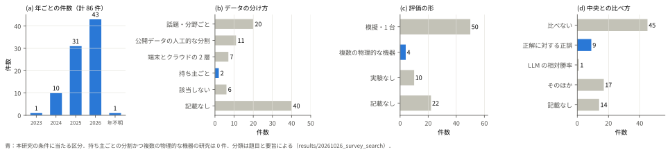
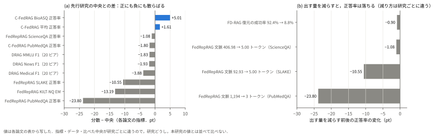
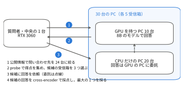
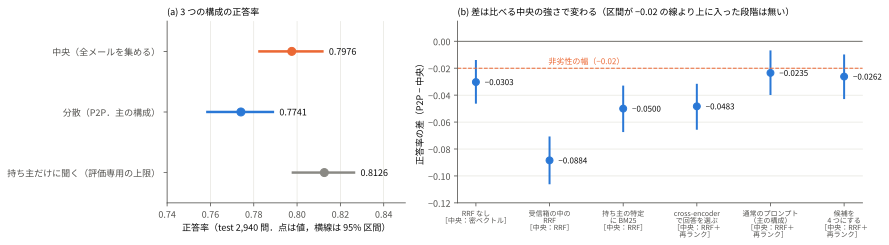
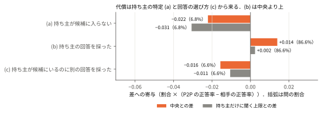
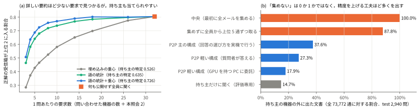

# d0008 報告書（A4 判・2 段組み・8 ページ）の outline

- 作成日：2026-10-25．改訂：2026-10-28（`docs/trend_analysis.md` の傾向に合わせ，「背景 → 単一の分類軸 → 代表研究の定型紹介 → ギャップ → 展望」の骨格，英語 Abstract と英語の図キャプション，図 6・表 2 の規模に組み直した）
- 置き場所：`docs/d0008_report_outline.md`
- 目的：この outline に沿って報告書の本文（`docs/d0009_report.md` を想定）を書く．報告書は関連研究の調査（サーベイ）を主とし，研究発表の形（分野の俯瞰，関連研究の紹介，自身の研究の貢献）を取り入れる
- 使い方：
  - §0 で前提と用語を確かめ，§1〜§8 の箇条を上から順に段落へ起こす．1 つの最上位の箇条がおおむね 1 段落に当たり，入れ子の箇条はその段落で言う中身である．
  - 図は `docs/figures/d0008_*.svg` にあり，`uv run --with matplotlib python scripts/tasks/d0008_figure.py docs/figures` で記録から作り直せる．
  - 数値は付録 B の出どころで照合してから写す．字数が足りなければ付録 C から足し，あふれたら付録 C へ回す．
- 前提文書：`docs/d0007_p2p_vs_central_report.md`（p0007 の最終報告），`docs/d0006_research_overview.md`（研究全体），`docs/trend_analysis.md`（報告書の形式の傾向），`.claude/research/journal.md`・`journal_archive.md`，`results/20261026_survey_search/summary.md`（文献検索の記録）
- 原論文：引用する論文のうち 57 本を `papers/`（`.gitignore` 済み）に置き，本文で確かめた．入手できなかった論文は参考文献の注に示す．

---

## 0. 執筆の前提

### 0.1 報告書の形

- 発表要項：
  - 原則としてサーベイ発表とし，指導教員と相談して決めた題目の論文を精査し，自分の視点と言葉で整理・要約する．
  - 研究が十分に進み，M2・D2 の発表までにさらに進む見込みがあれば，指導教員と相談のうえ研究発表の形でもよい．その場合も分野全体を俯瞰して関連研究を紹介し，自身の研究の貢献を明確に示す．
- 本報告の形：サーベイを主とし，研究発表の形を一部取り入れる（指導教員の了承済み）．題目は決定済み（表題の節）．
  - §2〜§5（約 4 ページ）：背景を入門として説明し，分散 RAG を単一の軸（問い合わせ先を誰が決めるか）で整理し，代表研究を定型で紹介して，中央と比べて何が分かっていて何が分かっていないか（ギャップ）を示す．
  - §6〜§7（約 2 ページ）：ギャップの 1 つを，31 台の実機の測定で埋めた結果を示す．
  - §8：先行研究との関係，まとめ，M2 の発表までの計画を示す．

### 0.2 形式の傾向（`docs/trend_analysis.md`）との対応

| 傾向 | 本報告での扱い |
|---|---|
| A4 縦・8〜9 ページ | A4・2 段組み・8 ページ（本文 約 9.8 千字，図 6，表 2，式 3，参考文献 34 件で約 7.7〜8.0 ページ） |
| 日本語本文 + 英語 Abstract + 英語の図キャプション | 表題の下に日本語の概要と英語の Abstract を置き，図表のキャプションは英語で書く（本文中に書いた） |
| 番号付きのセクション・図・参考文献 | 全て番号付き．参考文献は本文の初出の順 |
| 図 3〜7 枚，表 0〜2 枚，参考文献 16〜46 件，数式は多くて 19 式 | 図 6 枚（二枚組みを含む），表 2 枚，参考文献 34 件，式 3 つ（式 (1) RRF，式 (2) 差，式 (3) 寄与） |
| はじめに → 背景 → 単一の分類軸 → 代表研究 → まとめと今後の課題 | §1 → §2 背景 → §3 分類軸（問い合わせ先を誰が決めるか）→ §4 代表研究 → §5 ギャップ → §6〜§8（本研究）．研究の部分は §5 のギャップを受ける形にした |
| 代表研究は「手法 → 実験結果（数値付き）→ 貢献と残る課題」の定型 | §4 の各研究を，この 3 つの箇条で書く |
| ギャップを「検索範囲では見つからなかった」と明示し，今後の課題にする | §5 で 86 件の分類を根拠に明示し，§8 の今後につなげる |
| 近年（2021〜2026）の研究が中心．基礎文献も引く | 86 件は 2023〜2026 年．基礎の 1995〜2021 年の文献も §2 で引く |

### 0.3 分量

1 ページ ≈ 2 段 × 45 行 × 24 字 ≈ 2,100 字として配分した．本文の字数は，この outline の各節の本文の箇条（表・英語キャプション・図の説明・式を除く）を数えた値で，書き起こすときにこれ以上は増やさない．テンプレートの字数が違えば比例で直す．

| 節 | 本文の字数 | 図表 | ページ |
|---|---|---|---|
| 表題・概要・Abstract | 日本語 350，英語 約 170 語 | － | 0.5 |
| §1 はじめに | 820 | － | 0.4 |
| §2 背景 | 840 | － | 0.4 |
| §3 分類軸と調査の方法 | 950 | 図 1（2 段抜き） | 0.8 |
| §4 代表研究 | 2,340 | 表 1（2 段抜き） | 1.6 |
| §5 ギャップ | 840 | 図 2（2 段抜き） | 0.7 |
| §6 本研究の実験系 | 980 | 図 3（段幅） | 0.65 |
| §7 結果 | 1,830 | 表 2（段幅），図 4（2 段抜き），図 5（段幅），図 6（2 段抜き） | 1.95 |
| §8 考察とまとめ | 1,180 | － | 0.55 |
| 参考文献 | 34 件 | － | 0.5 |
| 計 | 約 9,800（実測 9,787） | 図 6・表 2 | 8.05 |

- 8 ページを超えるときに削る順：§4 の GRaSP・Ding ら・FD-RAG の定型の箇条を 2 行に縮める → 図 2（§5 の本文に値を書いてある）→ 図 5（表 2 と §7.1 の本文で代えられる）．

### 0.4 中心のメッセージ

- 問い：データを 1 か所に集められない組織で，その制約を守って RAG を使うと，何をどれだけ失うか．それはなぜか．損失を減らすために何を差し出したか．
- 答え：
  - 集めない制約を守ると，精度は中央の約 97%（差 −0.02〜−0.03）になる．
  - この代償は「誰がデータを持っているか分からない」こと（持ち主の特定と，候補からの回答の選び方）に由来し，受信箱ごとに答えるという分散の構造そのものには由来しない．
  - 代償を下げるために一部の情報を出している（公開した要約から持ち主を 72.6% 当てられ，精度の構成では質問者に全体の 37.6% の文書が渡る）．
- 先行研究との接点：正しく振り分ければ中央に並ぶ（上回る）という報告と，隠すほど精度が落ちるという報告の両方があり，本研究の結果はどちらとも同じ向きである（§8.1）．
- 中央集約型は競合ではなく，制約が無い場合の参照点として扱う．「P2P は中央より優れる」とは書かない．

### 0.5 用語の説明（§2 と §6 で，初出のたびに短く説明する）

報告書の読み手は，LLM は知っていても検索や分散システムには詳しくないと想定する．

- 検索と生成
  - **RAG（検索拡張生成）**：質問に関係する文書を検索し，それを文脈として LLM に渡して答えさせる方式 [1]．LLM が学習していない組織内の情報にも答えられる．
  - **BM25**：質問と文書に共通する語の出現回数（ただし頭打ちがある）に，珍しい語ほど大きい重みをかけ，文書の長さで補正する古典的な検索．語の珍しさ（IDF）は文書の集まりの統計から計算する．
  - **密ベクトル検索**：文を埋め込み（数値のベクトル）にし，意味の近さで探す検索．本研究は arctic-embed-m-v1.5 [33] を使う．
  - **RRF**：複数の検索の順位 r を，1/(k + r) の和（k は定数で，原論文は k = 60 を予備実験で固定した）で 1 つにまとめる方法 [5]．本研究は BM25 と密ベクトルの結果をまとめる．
  - **cross-encoder（再ランク）**：質問と文書の組を 1 つずつモデルに入れて関連度を採点し直す方法．精度は高いが計算が重い．本研究は bge-reranker-v2-m3 [34] を使う．
- 構成
  - **受信箱と持ち主**：EnronQA の 1 人分のメールの集まりを受信箱，その人を持ち主と呼ぶ．各質問の正解のメールは 1 つの受信箱にある．
  - **中央（集約）**：全員のメールを 1 台に集めた索引で検索して答える構成．
  - **P2P（分散）**：各 PC が自分の置いた受信箱だけを持ち，質問した PC（質問者）が問い合わせ先を選んで聞く構成．メールは持ち主の PC から集めない．
  - **準集権**：索引は中央に集め，回答の生成だけを複数の GPU に分ける構成．負荷の比較のために置いた．
  - **委託**：GPU を持たない PC の受信箱について，近くの GPU を持つ PC に回答を作ってもらうこと．
- P2P の仕組み
  - **公開情報（要約）**：各 PC が前もって公開する，自分の受信箱の要約．語の統計（どの語が何回出るか）と，埋め込みの重心（メールの埋め込みの平均）を使う．
  - **probe**：候補の PC に質問を送り，得点だけを返してもらう問い合わせ．メールの中身は返さない．
  - **要求数**：1 問に答えるまでに機器へ送る要求の数．探す費用の目安になる．
- 評価
  - **hit@2**：正解の受信箱を上位 2 つの候補に入れられた問の割合．「見つけやすさ」を表す．
  - **正答率**：回答が正解と合っている問の割合．判定は別の LLM（判定モデル）が行う．
  - **持ち主の特定（出どころの推定）**：公開情報だけから，あるメールの持ち主を当てられる割合．公開情報がどれだけ持ち主を明かすかを表す．
  - **露出**：持ち主の PC の外に出た文書の量．全メールのうち何 % が外に出たかで表す．
  - **oracle**：正解の持ち主を前もって知っているとして，その受信箱だけに聞く評価専用の構成．実際には使えないが，P2P の上限を示す．
  - **差と代償**：差は「P2P の値 − 中央の値」で，負の値が代償を表す．「中央の何 %」は P2P の値 ÷ 中央の値で計算する．
  - **95% 区間と非劣性**：差の推定の幅を 95% 区間で示す．区間の下端が −0.02（δ）より上なら「中央に大きくは劣らない（非劣性）」と判定すると，実行の前に決めた．
  - **McNemar の検定**：同じ問に対する 2 つの構成の正誤を比べる検定．
  - **処理量**：1 秒あたりに，回答の生成まで終えた質問の数（問/秒）．質問者が同時に 30 問を送り続けて測り，1 条件 300 問を 3 回流した中央値と最小〜最大で示す．大きいほど，同じ時間にたくさんの質問をさばける．
  - **障害の指標**：機器が止まる窓（停止 45 秒を含む約 76 秒）の中で，質問に答えられた割合を時間で積分した値．止まっても答え続けられるほど大きい．

### 0.6 書き方の決まり

1. 差は符号を残して「差 −0.0235」のように書く（0.7741 ÷ 0.7976 ＝ 97.1%）．
2. 精度と露出は同じ構成の値を対にする．
   - 精度 97% の構成（主の構成）で回答の選び方を実機の経路で行うと，質問者に全体の 37.6% の文書が渡り，1 問あたりの要求は 27 である．
   - 露出 27.3% と「要求数 44% 減」は，別の軽い構成（正答率 0.6554）の値である．
3. 「持ち主の特定」と「回答の選び方」の比重は比べる相手で変わるので，「大部分は持ち主の特定」とは書かない．
4. 判定は事前に決めた規則によるものを先に書き，結果を見た後の見直しは「事後の見直し」と明記して並べる．
5. 新規性は「調べた範囲で」と書く．ルーティングの個々の方式は既存の資源選択（ReDDE・CORI など）の再実装であり，方式の新規性は主張しない．
6. 言わないこと：「P2P は中央より優れる」，「宿る型は安全」，「中央方式一般より」，攻撃への耐性，差分プライバシーの保証，GPU の共有状況．
7. 先行研究の数値は，その研究の主張として，指標・データ・比べた中央を添えて紹介する．本研究の数値と同じ表で比べない．
8. サーベイの部分は，論文を 1 本ずつ「手法 → 実験結果（数値）→ 貢献と残る課題」の 3 点で紹介し，その後に「何が分かっていて，何が分かっていないか」を自分の言葉で書く．
9. 説明や例えを足すときも，関連研究か実験の記録で裏付けられることだけを書く．
10. 日本語の「である」調で書く．句読点は「，」「．」．実在のメール本文を載せない．図表のキャプションと Abstract は英語で書く．

### 0.7 執筆前に決めること

- 決定済み：題目（コロンを使わず「調査」を含める），研究発表を一部取り入れる形，M2 の発表までの当面の計画（§8.3 の (1)〜(3)），図は現状のまま使う．
- 字数・行数・書式は，LaTeX で実際に書きながら §0.3 の配分を調整する．

---

## 表題・概要・Abstract

題目：分散 RAG における中央集約との精度・露出のトレードオフに関する調査

英語題目：A Survey on the Accuracy–Exposure Trade-off between Distributed and Centralized RAG

概要の文案（日本語．約 350 字）：

> 組織のデータは部署や個人の PC に分かれ，1 か所に集められないことが多い．本稿では，データを集めずに検索拡張生成（RAG）を行う研究を，その源流の分散情報検索とともに，「問い合わせ先を誰が決めるか」の軸で整理した．文献検索で得た分散 RAG の 86 件では，中央との比較が話題や公開データの人工的な分割，シミュレーション，限られた指標に偏り，持ち主で分けたデータを複数の実機に置いた研究は見当たらなかった．そこで，150 人分の私的メール（EnronQA）を 31 台の実機に分け，同じ検索の改良を入れた中央と比べた．分散した構成の精度は中央の 97.1%（差 −0.0235）で，持ち主を正しく特定できれば中央と同程度以上（0.8126 対 0.7976）だった．代償は持ち主の特定と回答の選び方に由来する．その代わりデータの多くは持ち主の外に出ない（精度の構成で 37.6%）が，公開した要約から持ち主を 72.6% 当てられる．

Abstract（英語．約 170 語）：

> Organizational data are often scattered across departmental and personal PCs and cannot be gathered in one place. This paper surveys retrieval-augmented generation (RAG) that does not pool data, together with its roots in distributed information retrieval, and organizes it along a single axis: who decides which data source to ask. Among 86 distributed-RAG papers found by a systematic search, comparisons with a centralized baseline rely on topic-based or artificially split public data, simulation, and heterogeneous metrics; none places owner-partitioned private data on multiple physical devices. To fill this gap, we split 150 private mailboxes (EnronQA) across 31 machines and compared a distributed system with a centralized one that received the same retrieval improvements. The distributed system reached 97.1% of the central accuracy (difference −0.0235), and asking only the true owner matched or exceeded the central system (0.8126 vs. 0.7976). The cost stems from identifying the owner and choosing among candidate answers, not from answering per mailbox. In exchange, most documents stay on their owners' machines (37.6% leave in the accuracy-oriented configuration), yet the published summaries reveal the owner of a mail with 72.6% top-1 accuracy.

Keywords：Retrieval-Augmented Generation, Distributed Information Retrieval, Federated Search, Data Silos, Privacy．

---

## §1 はじめに（約 800 字）

- 組織のデータは 1 か所に集められないことが多い．
  - メールや文書は部署や個人の PC に分かれて置かれる．
  - 法令・契約・組織の都合で，それらを 1 か所に集められない（いわゆる縦割り）．
- 一方，RAG [1] の多くは文書を 1 か所に集めた索引を前提にする．先行研究もこの前提を問題にしている．
  - FD-RAG [2]：既存の RAG の多くが単一の知識の置き場を前提にすると述べる．
  - DGRAG [3]：中央に集める構成の通信・計算の負担と，医療・金融・行政でのプライバシーと法令順守の危険を指摘する．
- 本稿の問い：集めない制約を守るとき，中央に集めた場合と比べて何をどれだけ失うか．
  - 何を：精度・露出・時間・計算．
  - なぜ：損失はどこから来るか．
  - 引き換えに：損失を減らすために何を差し出したか．
  - 中央は参照点であり，分散と中央の優劣を競うものではない．
- 本稿の位置づけと貢献（調べた範囲で）：
  - 前半（§2〜§5）は関連研究の調査，後半（§6〜§8）は筆者の研究である．研究の経緯は，研究室の無線アドホック連合学習（WAFL）[4] の系譜から，重みを混ぜる協調学習を離れ，各デバイスのデータと LLM が連携する協調推論へ移ったことにある．中央集約との比較は指導教員の要請で加えた．
  - S1：分散 RAG を「問い合わせ先を誰が決めるか」の軸で 3 つの型に整理し，代表研究を定型で紹介した（§3，§4）．
  - S2：中央と比べて何が分かっているかを 3 点にまとめ，86 件の分類から，持ち主で分けたデータを複数の実機に置いた研究が見当たらないというギャップを示した（§5）．
  - R1：持ち主で分かれた私的データで，31 台の実機の上で，同じ改良を入れた中央との正答率の差（分散の代償）を測った．
  - R2：代償を内訳に分け，持ち主の特定と回答の選び方に由来し，受信箱ごとに答える構造には由来しないことを示した．
  - R3：代償を減らすために差し出した露出と，精度以外の代償（探す費用・時間・計算・エネルギー）を同じ実機で測った（§7）．

---

## §2 背景（約 900 字）

### 2.1 RAG と検索の基礎（約 400 字）

- LLM は学習した知識で答えるので，組織内の私的な情報や学習より新しい情報は知らない．RAG [1] は，質問に関係する文書を検索して文脈として渡し，LLM に答えさせる．
- 検索には，語の一致に基づく BM25 と，意味の近さに基づく密ベクトル検索がある．両者の順位を式 (1) の RRF [5] で 1 つにまとめ，上位の文書を cross-encoder で採点し直す構成が一般的である（用語は §0.5）．

式 (1)：RRF(d) = Σ_i 1 / (k + r_i(d))．r_i(d) は検索 i での文書 d の順位，k = 60．

- 回答の正誤は，別の LLM に判定させて測る．判定にも誤りがあるので，別解や誤答を使って検証する．

### 2.2 分散情報検索（約 450 字）

- 連合検索は，複数の独立したデータ源を 1 つの入口から検索する技術で，資源の表現（各データ源の中身をどう記述するか）・資源の選択（どのデータ源に聞くか）・結果の統合の 3 つの問題からなる [6]．資源の表現には，データ源が統計を公開する協力的な形と，質問を投げて標本を集める非協力的な形（query-based sampling [7]）がある．
- 資源の選択の代表的な手法：CORI [8] はデータ源ごとの語の統計で順位づける．ReDDE [9] は各データ源の標本を 1 つの索引にまとめて検索し，データ源の大きさも使って，関連する文書を多く持つデータ源を選ぶ．Taily [10] は語の統計から得点の分布をガンマ分布で推定し，標本を使わずに選ぶ．
- 選択的検索 [11][12] は，コーパスを話題のシャードに分け，質問ごとに一部だけを検索する．適合率を重視する評価では，全検索と同等の質を保ちながら費用が大きく下がり，最適なシャードを与える oracle では全検索を上回りうる [11]．並列の環境では，細かいシミュレーションで，処理量が高く待ち時間も短いと示された [12]．計算資源の少ない組織でも大規模な検索をできるようにする動機は，「既存の PC で RAG を」という本研究と通じる．
- ピアの間で質問を転送する P2P の情報検索 [13] は，本研究の近傍の転送の源流である．本研究のルーティングはこの系譜の再実装であり，方式の新規性は主張しない．

---

## §3 分類軸と調査の方法（約 700 字）

### 3.1 分類軸：問い合わせ先を誰が決めるか（約 250 字）

- 分散 RAG は，軸 2「どのデータ源に聞くかを，誰が・何で決めるか」（分散情報検索の「資源の選択」に当たる）で 3 つの型に分けると整理しやすい．
  - 型 1：中央が学習した分類器で選ぶ．
  - 型 2：中央が，各データ源の公開した要約で選ぶ（または全員に聞く）．
  - 型 3：中央を置かず，ピアが探す．
- 補助の軸は，軸 1 データの置き場所，軸 3 生成の場所，軸 4 境界を越えるもの（公開情報は「資源の表現」に当たる）である．中央との比べ方は，データの分け方（話題か，人工的な分割か，持ち主か），評価の形（模擬か，実機か），比べ方（指標と，どんな中央か）の 3 つの観点で見る．この 3 つが，本研究と先行研究の違いを最もはっきり示す．

### 3.2 調査の方法（約 300 字）

- 調査の問い：(1) データを集めずに RAG を行う構成にはどのような型があるか，(2) 中央とどう比べられてきたか，(3) 分散させたときに何が漏れるか，(4) 生成をどこで行うか．
- 探し方：arXiv と Semantic Scholar の API，ACL Anthology・ACM・IEEE の Web 検索で，federated RAG，distributed RAG，peer-to-peer RAG，RAG data silos など 8 つの語を 2020 年 1 月〜2026 年 10 月の範囲で検索し，総説 [14][15] の参考文献で補った．検索と生成を複数の主体にまたがって行うものと，分散させたときの漏洩を扱うものを含め，検索を持たない連合学習と応用の事例報告は除いた．
- 件数：1,166 件を得て，重複を除いて 734 件，題目と要旨で分散 RAG の 86 件を選んだ．選別と分類は題目と要旨による筆者 1 人の判定で，表 1 の論文と反例の候補は本文を確かめた．

図 1（2 段抜き）：文献検索の結果．(a) 年ごとの件数，(b)〜(d) 86 件の分類（どのパネルも合計は 86 件）．青は本研究の条件に当たる区分である．

英語キャプション：Figure 1. Results of the literature search. (a) Papers per year; (b)–(d) classification of the 86 distributed-RAG papers by data partition, evaluation form, and comparison with a centralized baseline (every panel sums to 86; blue marks the categories matching this study).

- 図 1 から読み取ること（本文で述べる）：論文は 2023 年 1 件，2024 年 10 件，2025 年 31 件，2026 年 43 件（年不明 1 件）と急増している．データの分け方は話題・分野ごと（20 件）や公開データの人工的な分割（11 件）が多く，持ち主ごとは 2 件しかない．評価は模擬・1 台が 50 件で，複数の物理的な機器は 4 件しかない．中央と正解に対する正誤で比べたものは 9 件で，中央に同じ検索の改良を入れたと明示したものは 1 件だった．持ち主で分けたデータを複数の物理的な機器に置いた研究は 0 件だった（ほかの区分の件数は図 1 に示す）．

---

## §4 代表研究（約 2,400 字）

各研究を「手法 → 実験結果（数値）→ 貢献と残る課題」の 3 点で紹介する．数値は各論文の主張である．

### 4.1 型 1：中央が学習した分類器で選ぶ（約 280 字）

- RAGRoute [16]
  - 手法：中央の小さな分類器が問い合わせ先を選び，中央の LLM が答える．データ源が加わると，影響を受ける源へ問い合わせて学習の正解を作り直し，学習し直す．
  - 結果：通信量を最大 80.65%，待ち時間を最大 52.50% 減らし，データ源の選択の再現率は最大 89.70%．FeB4RAG [17] では 1 問あたり 9.20 のデータ源に問い合わせる（筆者の再現は 9.44）．
  - 貢献と残る課題：問い合わせ先を賢く選べる．比較の相手は全データ源に聞く方式で，中央に集めた索引ではない．学習の時にいなかったデータ源の見落としは §7.2 で実測した．

### 4.2 型 2：中央が，公開された要約で選ぶ（または全員に聞く）（約 1,150 字）

- RIRS [18]
  - 手法：各エージェントが知識の埋め込みのクラスタの中心だけを公開し，サーバーが質問と照合して振り分ける．学習が要らず，エージェントを足しても再学習がいらない．
  - 結果：Wikipedia を 64 のカテゴリに分け，正しく振り分ける oracle は，知識を 1 か所に集めた単一エージェントより，多段の質問で GPT 判定の正答率が最大 5% 高い．
  - 貢献と残る課題：集めると関連の薄い文書が混じると指摘する．評価は話題で分けた公開データの模擬である．
- DGRAG [3]
  - 手法：各エッジが文書を知識グラフにして要約だけをクラウドに上げ，エッジの小型モデルで答えられない質問だけをクラウドに送る．
  - 結果：全エッジの知識を集めた中央に対する LLM 判定の相対勝率が，自分の分野 66.8%・他の分野 73.5%．クラウドの保存は 13.03 MB 対 1.53 GB，入力トークンは中央の 39%（自分の分野の質問では，クラウドの LLM に勝率 36.3% で負ける）．
  - 貢献と残る課題：クラウドの負担を減らす．物理的な機器の台数は書かれておらず，帯域を設定した計測にとどまる．
- FD-RAG [2]
  - 手法：各デバイスのコーパスを質問と回答の組の記憶に要約し，記憶で答えられる質問は LLM を呼ばない．サーバーが記憶を集めて全体の記憶にまとめる．
  - 結果：公開データを 5 クライアントに分けた模擬で，RAGRoute と C-FedRAG を正答率で上回る（時間はエッジの機器 1 台）．
  - 貢献と残る課題：記憶の共有に局所差分プライバシーを入れた（§4.4）．中央に集めた構成との比較は無い．
- FedRepRAG [19]
  - 手法：サーバーが質問の埋め込みを全クライアントへ送り，返った類似度で上位の表現を選ぶ．文書の代わりに潜在表現だけを交換する．
  - 結果：生の文脈を集める連合構成は中央と同じ値になる．表現だけにすると，文脈は 1 問あたり 92.93 から 5.00 トークンに減るが，正答率は 71.25 から 60.70 に下がる（SLAKE．PubMedQA では 82.20 から 58.40）．
  - 貢献と残る課題：文書を出さずに連合できるが，全てのデータで中央を下回る（10 クライアントの人工的な分割の模擬）．
- C-FedRAG [20]
  - 手法：学習せず，全提供者に問い合わせ，集めた断片を中央の調整役が再ランクして，機密計算の環境の LLM が答える．
  - 結果：医療の 4 コーパスを 2 サイトに分け，まとめた中央に対し，平均の正答率が 72.51 対 70.90 と上回る（PubMedQA は 65.40 対 67.20 で下回る）．
  - 貢献と残る課題：集めずに中央に並ぶ．時間や費用は未測定．
- GRaSP [21]・Ding ら [22]：GRaSP は，待ち時間と関連度で取る地域を中央が選び，5 台の試験環境で広域網を模擬して，置き方（一様か話題ごとか）で効果が変わることを示した（目的は待ち時間と費用）．Ding らは，既存の評価が検索の資源をそろえずに中央と比べていると指摘し，予算をそろえて比べた．本研究の公平性の原則（§6.2）と同じ問題意識である．

### 4.3 型 3：中央を置かず，ピアが探す（約 230 字）

- DRAG [23]
  - 手法：各ピアが知識と LLM を持ち，LLM で質問の話題を取り出して相手を探すランダムウォークで問い合わせる．
  - 結果：公開データ 3 種の 20〜100 ピアのシミュレーションで，20 ピアでの中央との差は F1 で −1.8〜−3.9 pt，100 ピアの MMLU で −6.0 pt．メッセージ数は 100 ピアで一斉照会の約半分．中央の知識が 7 割しかないと，DRAG の F1（83.92）が中央（61.54）を上回る．
  - 貢献と残る課題：中央の調整役を持たない唯一の型．評価はシミュレーションである．
- 本研究の質問者は問い合わせ先を自分で決めるので，型 2 と型 3 の間に位置づく．

### 4.4 プライバシーと生成の場所（約 300 字）

- RAG に固有のリスクは，索引からの文書の抽出，特定の文書が索引にあるかを当てる攻撃，学習データの抽出 [24]，埋め込みやベクトルデータベースからの漏洩 [25] に整理されている．分散させても，公開する要約・送る質問・返す文書が漏洩の経路になる．
- 隠す量と精度の兼ね合い：FD-RAG は，記憶の固有名詞を局所差分プライバシー（ε = 1.0）で置き換えて，復元の成功率を 92.4% から 8.8% に下げ，正答率は 53.9 から 53.0 に下がった．FedRepRAG は，潜在表現の交換でも質問の 5.4% と文脈の 11.0% が復元されると報告した．
- 出どころの秘匿：連合検索にはデータ源を秘匿するプロトコルが提案され [26]，連合学習にはデータの持ち主を推定する攻撃がある [27]．本研究の「公開情報から持ち主を当てる」指標は，この出どころの推定の一種である（防御は提案せず，攻撃への耐性も主張しない）．
- 生成の場所：端末上の LLM [28] と，エッジとクラウドの協調 [29] の研究がある．本研究の「誰が答えるか」（質問者，持ち主，GPU を持つ PC への委託）は，既存 PC の間のオフロードの実測に当たる．総説 [14][15] は，現実的な攻撃者のもとでの兼ね合いと，組織をまたぐ評価の手順を未解決の課題に挙げる．

表 1（2 段抜き）：先行研究の分類．紙面が足りなければ選択的検索の行を本文に移す．表の下に「FeB4RAG は評価集合なので本文で触れる」と注を付ける．

英語キャプション：Table 1. Classification of prior work along four axes (data placement, who decides which source to ask, where generation happens, what crosses the boundary) and three viewpoints (data partition, evaluation form, comparison with a centralized baseline).

| 研究 | 型 | 軸 1 データ | 軸 2 決定 | 軸 3 生成 | 軸 4 境界を越えるもの | データの分け方 | 評価の形 | 中央との比べ方 |
|---|---|---|---|---|---|---|---|---|
| 選択的検索 [11] | － | 話題のシャード | 中央の資源選択 | － | － | 話題 | 実装（並列の環境） | 全シャードの検索と，検索の質と費用で比べる |
| RAGRoute [16] | 1 | 分散 | 中央の分類器 | 中央 | 文書 | 公開コーパスごと（MMLU は人工分割） | 実装 | 全データ源に聞く方式と，問い合わせ数と精度で比べる |
| RIRS [18] | 2 | 分散（エージェント） | 中央のサーバーが要約で振り分ける | エージェント | 要約・回答 | 話題（Wikipedia の 64 カテゴリ） | シミュレーション | 1 か所に集めた単一エージェントと，oracle の振り分けで比べる |
| C-FedRAG [20] | 2 | 分散 | 全提供者に聞き，中央が再ランク | 中央（機密計算） | 文書（保護下） | 公開コーパスごと（4 コーパスを 2 サイトへ） | 模擬の 2 サイト | 正答率で，4 コーパスをまとめた中央と比べる |
| DGRAG [3] | 2 | 分散（エッジ） | クラウドが要約で | エッジとクラウド | 要約・証拠 | 分野（教科書） | 帯域を設定した計測 | LLM の相対勝率と，正解との再現率．保存・トークン |
| FD-RAG [2] | 2 | 分散（エッジ） | 記憶の照合．サーバーが記憶を集約 | 必要時に LLM | 匿名化した記憶 | 公開データの人工分割 | 模擬＋エッジ 1 台の時間 | 連合の方式どうしの比較が中心 |
| FedRepRAG [19] | 2 | 分散 | 中央のサーバーが全クライアントへ送り，類似度で上位を選ぶ | 質問したクライアント | 潜在表現 | 公開データの人工分割 | 模擬（GPU 1 枚） | 正答率と文脈の量で中央と並べる（全てのデータで中央を下回る） |
| GRaSP [21] | 2 | 地域ごとの置き場（索引は問い合わせ元の近く，分散は本文のみ） | 中央が待ち時間と関連度で選ぶ | 本文に記述なし | 文書 | 公開コーパスの配置 | 5 台で WAN を模擬 | 関連度だけの選択と，EM と待ち時間で比べる |
| Ding ら [22] | 2 | 分散（5 クライアント） | 中央の再ランク | 中央 | 検索の候補 | 公開データの人工分割 | 模擬 | 検索の予算をそろえた中央と，正答率で比べる |
| DRAG [23] | 3 | 分散（P2P） | ランダムウォーク | 各ピア | フィルタ済みの知識断片 | 本文に記述なし（公開データ） | シミュレーション（20〜100 ピア） | 精度（EM・F1）とメッセージ数 |
| 本研究 | 2〜3 | 持ち主（150 受信箱） | 質問者（要約＋probe） | 質問者・持ち主・委託先の GPU | 公開情報・質問・文書・回答 | 持ち主 | 31 台の実機 | 同じ改良を入れた中央との正答率の差．露出・時間・計算・GPU のエネルギーも同じ実機で |

---

## §5 ギャップ：中央と比べて何が分かっているか（約 500 字）

### 5.1 先行研究から分かること

先行研究の中央との比較から，次の 3 点が読み取れる（図 2）．

- 正しく振り分ければ，中央に並ぶ（上回る）ことがある：RIRS の oracle，C-FedRAG の平均，DRAG の中央の知識が不完全な場合．
- 隠すほど，精度は落ちる：FedRepRAG は文脈の量を減らすと 1〜24 pt 落とし，FD-RAG は復元の成功率を下げる代わりに 0.9 pt 落とす．
- 比べ方がそろっていない：データは話題や公開データの人工的な分割，評価はシミュレーションか限られた計測，指標は研究ごとに違い，中央に同じ検索の改良を入れたと明示するのは 86 件中 1 件（Ding ら）だった．

図 2（2 段抜き）：先行研究の中央との差（a）と，出す量を減らしたときの正答率の変化（b）．値は各論文の表から写した．

英語キャプション：Figure 2. (a) Gap to the centralized baseline reported by prior work (distributed − central, in each paper's own metric). (b) Change in accuracy when the amount of exposed information is reduced. Values are copied from each paper's tables; metrics, data, and baselines differ across studies, so the bars are not comparable between studies.

### 5.2 空白と研究の問い

- 公開知識のベンチマーク [30] では，誰に聞くかの価値が見えにくい．筆者の予備実験でも，医療 QA 7,663 問で，全員に聞く 65.9%，学習した分類器 65.7%，無作為 65.4%，検索なし 64.0% と差が出なかった．私的データの EnronQA [31] は，150 人の受信箱のメールに合成の質問を付けたもので，検索なしの正答率が 5% 未満である．正しい受信箱に聞かないと答えられず，持ち主でデータが分かれているので，分散の代償を測るのに適する．
- 分散の代償という考え方は，縦型の連合学習で理論的に定量化されている [32]（分割の軸が違い，概念を借りる．実データでの評価は今後の課題とされる）．
- 空白（§3.2 の 734 件・分散 RAG 86 件の範囲で見当たらないもの）：
  1. 持ち主で分かれた私的データで，同じ実機・同じモデルの上で，中央と分散を精度・露出・時間・計算の同じ軸で比べ，分散の代償を定量化した研究．
  2. 代償の内訳（持ち主の特定・回答の選び方）を分けた研究．
  3. 出どころの推定を，公開情報の量と見つけやすさの兼ね合いとして測った研究．
- 研究の問い：RQ1 集めない制約の精度の代償はいくらか．RQ2 代償はどこから来るか（構造そのもの・持ち主の特定・回答の選び方）．RQ3 代償を減らすために何を差し出したか．RQ4 精度以外の代償（探す費用・時間・計算・エネルギー）は何か．

---

## §6 本研究の実験系（約 800 字）

### 6.1 機材・データ・システム（約 380 字）

- 想定：各 PC が持ち主のデータ（受信箱）と LLM を持ち，GPU を持つ PC と持たない PC が混在し，データは持ち主の PC の外へ集めない．
- 機材：31 台の実機を同一の有線 LAN でつないだ．質問者と中央を兼ねる 1 台（RTX 3060），GPU を持つ PC 10 台（RTX 3060 12 GB），CPU だけの PC 20 台（i5-8350U）．
- データ：EnronQA の 150 受信箱・73,772 通を，各台のメール数がおおむね等しくなるように 30 台へ 5 受信箱ずつ置いた．評価は test 2,940 問で，設定の選択には dev 2,948 問を使った．
- モデル：回答は llama3.1:8b（温度 0），判定は qwen3:8b，埋め込みは arctic-embed-m-v1.5 [33]，再ランクは bge-reranker-v2-m3 [34] で，中央と分散で同じものを使った．
- P2P で 1 問に答える流れ（図 3）：(1) 公開情報で問い合わせ先を 24 台に絞る，(2) probe で得点を集めて候補の受信箱を 3 つ選ぶ，(3) 各候補がその受信箱の上位 5 通だけで 8B が答える（CPU だけの PC の受信箱は，対応づけた GPU を持つ PC が答える），(4) 質問者が cross-encoder で候補の回答を 1 つ選ぶ．

図 3（段幅）：実験系と P2P で 1 問に答える流れ．番号は上の手順に対応する．

英語キャプション：Figure 3. Experimental setup and the four steps by which the P2P system answers a question: (1) narrow down to 24 machines with published summaries, (2) collect probe scores and pick three candidate mailboxes, (3) request an answer from each candidate (CPU-only machines delegate to a GPU machine), (4) score the candidate answers with a cross-encoder and take the best one.

### 6.2 比べる構成と評価の方法（約 270 字）

- 比べる構成：中央（全メールを 1 台に集め，BM25 と密ベクトルの RRF（式 (1)）で上位 50 通，cross-encoder で上位 5 通に並べ替えて答える），準集権（索引は中央と同じで，生成だけを GPU を持つ PC 10 台に分ける），P2P（主：§6.1 の流れ．候補 4：候補を 4 つにしたもの．軽い構成：公開情報で 16 台に絞り，上位 2 受信箱を質問者が受け取って答える），oracle（評価専用．持ち主の受信箱だけに聞く）．
- 公平性の原則：P2P の検索を改良したら，中央にも同じ改良を入れて比べる（主の構成を RRF だけの中央と比べると +0.0088 で，非劣性に見えてしまう）．
- 測り方：精度は判定モデルによる正答率（別解を正とした割合 0.956，誤答を誤とした割合 0.984）．差は式 (2)，内訳の寄与は式 (3)．95% 区間はブートストラップ，優越は McNemar の正確検定で，非劣性の幅は δ = 0.02（流し直しの揺れの約 3 倍）．判定の規則は実行の前に記録して公開し（事前登録），設定は dev で選び test で 1 回だけ判定した．

式 (2)：Δ = A_P2P − A_central．A は正答率．
式 (3)：c_s = n_s/N × (A_P2P,s − A_central,s)．s は問の区分，n_s/N はその区分の割合．

---

## §7 結果（約 1,500 字）

- 節の流れ（本文の冒頭で 1 文で示す）：まず表 2 で全体を示し，精度の代償（§7.1），露出との交換（§7.2），精度以外の代償（§7.3）の順に詳しく述べる．

表 2（段幅）：中央に対する P2P の成績表．表の下に「精度は test 2,940 問（主の構成は失敗 1 問を除く 2,939 問）．露出の 37.6% は主の構成で回答の選び方を実機で行う経路，27.3% は軽い構成の値」と注を付ける．

英語キャプション：Table 2. Scorecard of the P2P system against the central system. Verdicts follow the rules fixed before the experiments; post-hoc revisions are marked.

| 軸 | P2P は中央に | 根拠の数値（P2P 対 中央） | 事前に決めた規則での判定 | 条件・仮定 |
|---|---|---|---|---|
| 精度 | 劣る | 主 0.7741 対 0.7976（差 −0.0235，95% 区間 −0.0391〜−0.0075）．候補 4 は 0.7714（−0.0262） | 非劣性・優越とも不成立 | 中央にも同じ改良を入れた比較 |
| 露出 | 優れる | 外に出た文書：主 37.6%，軽い構成 27.3%．中央は 100% | 成立（50% 未満） | 公開情報から持ち主を 72.6% 当てられる |
| 新しいメールへの追従 | 条件つき | 答えられるまで 0.394 秒 対 39.29 秒（中央が 60 秒ごとに転送） | 不成立．事後の見直しで成立 | 中央が受け取った直後に埋め込んで索引へ足せば 0.040 秒で速い（密ベクトルの索引は追加だけで済む）．BM25 を含む標準構成は未測定 |
| 負荷 | 条件つき | 処理量 0.581〜0.626 対 0.531〜0.537 問/秒 | 成立 | 流し直しで逆転．準集権は P2P の 2.4 倍 |
| 障害 | 条件つき | 答えられた割合の時間積分 23.8〜53.7 対 22.8 | 成立 | 中央が 45 秒止まる仮定に依る |
| 参加 | 劣る | 答えられるまで 1,283 秒 対 80.9 秒 | 不成立 | 時間の 99.6% は CPU での埋め込み |
| エネルギー（GPU のみ） | 劣る | 1,100 対 311 J/問 | 規則なし | CPU は測れない |

### 7.1 精度の代償とその内訳（RQ1・RQ2．約 500 字）

図 4（2 段抜き）：(a) 3 つの構成の正答率と 95% 区間，(b) 改良の段階ごとの中央との差．

英語キャプション：Figure 4. (a) Accuracy of the central, P2P (main configuration), and owner-only (oracle) systems with 95% intervals. (b) Difference from the central baseline at each improvement stage; the central baseline received the same improvement at each stage (labels in brackets).

- RQ1（図 4）：最良の P2P（主の構成）は 0.7741 で，同じ改良を入れた中央（0.7976）の 97.1% だった．差は −0.0235（95% 区間 −0.0391〜−0.0075，p = 0.0043）で，非劣性（δ = 0.02）を満たさない．候補を 4 にしても −0.0262 で変わらない．代償は比べる中央の強さで変わり，同じ改良（RRF）を入れると中央の方が大きく伸び（P2P +0.032 対 中央 +0.090），差は段階ごとに −0.03〜−0.09 の間を動く．弱い中央と比べると代償を過小に見積もる．
- RQ2：構造そのものではない．持ち主の受信箱だけに聞く oracle は 0.8126 で，中央と同程度以上だった（+0.0150，p = 0.069）．差は，持ち主の特定と回答の選び方から来る．主の構成の差を問の 3 つの区分に分けて，式 (3) の寄与で示した（図 5）．
- 差を縮めた工夫：持ち主の特定に BM25 の probe を使う（持ち主が候補に入る割合 0.8391 → 0.9320），cross-encoder で候補の回答を選ぶ，「わからない」と答えさせるプロンプトをやめる（+0.0248）．

図 5（段幅）：主の構成の差の内訳．

英語キャプション：Figure 5. Contribution of three question groups to the accuracy difference of the P2P system (main configuration) against the central system and against the oracle: (a) the owner is not among the candidates, (b) the owner's answer was chosen, (c) the owner is a candidate but another answer was chosen.

- 図 5 の読み方：(a) 持ち主が候補に入らない問（6.8%）の寄与は −0.022（持ち主の特定の失敗），(b) 持ち主の回答を採った問（86.6%）は +0.014（中央より高い），(c) 持ち主が候補にいるのに別の回答を採った問（6.6%）は −0.016（回答の選び方の失敗）．候補から完全に選べても 0.799 で中央に届かず，届かない分は持ち主の特定にある．候補を 4 にすると (a) は減るが (c) が増えた．

### 7.2 露出との交換（RQ3．約 400 字）

図 6（2 段抜き）：(a) 公開情報の種類ごとの，1 問あたりの要求数と見つけやすさ（30 台・test．凡例の括弧は，公開情報から持ち主を当てられる割合），(b) 構成ごとの，外に出た重複なしの文書の割合（全 73,772 通に対する割合）．

英語キャプション：Figure 6. (a) Requests per question versus hit@2 for each type of published summary (30 machines, test; the number in parentheses is the top-1 accuracy of identifying a mail's owner from the summary alone). (b) Fraction of the 73,772 emails that left the owners' machines, by configuration.

- 図 6(a)：何も公開せず全員に聞くと（右上の四角），32 の要求で正解の受信箱を上位 2 に入れる割合は 0.804 である．語の統計＋重心は 18 の要求で 0.802 と同じ見つけやすさを保つが，詳しい要約ほど持ち主を当てられやすい（重心 0.526，語の統計 0.635，語の統計＋重心 0.726）．
- 図 6(b)：中央は全メールを集める（100%）．集めずに全員から上位 5 通ずつ取る構成でも 87.8%，P2P の軽い構成は 27.3%（委託すると 17.9%），精度の構成で回答の選び方を実機で行う経路は 37.6% で，精度を上げる工夫ほど多くを出す．「集めない」は 0 か 1 かではなく，代償を下げるために一部を出している．
- 公開情報で選ぶ方式は学習を要さない．学習の時にいなかった受信箱 30 個を正解とする 600 問で，素朴な中央の分類器は学習し直さないと上位 2 に入る割合が 0.118 に落ち，全員に聞く方式は 0.802 を保った．

### 7.3 精度以外の代償（RQ4．約 450 字）

- 探す費用：処理量は 1 問あたりの要求数の逆数でよく説明できた（比 0.977〜1.054）．公開情報で絞ると要求数は 32 から 18 に減る（44% 減）が，この軽い構成の正答率は 0.6554 で，持ち主を 1 位で当てないと正しく答えられない．
- 時間：新しいメールは持ち主の PC で 0.394 秒後に使える．中央が 60 秒ごとにまとめて転送するなら P2P が速いが，受け取った直後に埋め込んで索引へ足す中央は 0.040 秒で速い．中央の索引は学習したモデルではなく埋め込みを並べたもので，追加は 1 通分の埋め込み（約 23 ミリ秒）と索引への追加（約 49 マイクロ秒）で済み，学び直しは要らない．ただし測ったのは密ベクトルの追加だけで，BM25 を含む標準構成の費用は未測定であり，受け取った直後の追従には，持ち主の PC がメールを送り続ける前提（「集めない」制約と両立しない）が要る．新しい PC の参加は，CPU で全メールを埋め込むため 1,283 秒かかり，中央（80.9 秒）の 15.9 倍だった．
- 負荷（処理量）：同時に 30 問を送ったときの処理量は，P2P が 0.581〜0.626 問/秒，中央が 0.531〜0.537 問/秒で，約 1.1 倍だった．ただし生成だけを 10 枚の GPU に分ける準集権は 0.732〜1.414 問/秒で P2P の約 2.4 倍であり，P2P の優位は分散の構造によるものではない．
- 障害：P2P は答えられる割合が下がるだけで止まらないが，この比較は中央が 45 秒止まる仮定に依る．止まった PC を検出できないと，答えられる割合は 0.74 から 0.03（10 台停止）まで下がった．
- 構造に由来する代償は持ち主の特定と台数に比例する要求数，実装で減らせる代償は参加の埋め込み・障害の検出・質問者での採点の集中（生成が速い条件で処理量が 0.593 倍）である．

---

## §8 考察とまとめ（約 900 字）

### 8.1 示唆と先行研究との関係（約 450 字）

- 集めない制約の代償は，データの場所ではなく所在が分からないことにある（§7.1）．所在を知る仕組みへの投資が，集約より効く可能性があるが，所在の手がかり自体が出どころの推定を助ける（§7.2）．
- §5.1 の 3 点と，本研究の結果は同じ向きである．正しく振り分ければ中央に並ぶ（RIRS の oracle が単一エージェントを上回ることと，本研究の oracle 0.8126 が中央 0.7976 と同程度以上であることが対応する）．隠すほど落ちる（FedRepRAG が文脈を減らすと落ちることと，露出の小さい軽い構成（27.3%）の正答率が 0.6554，精度の構成（37.6%）が 0.7741 であることが対応する）．
- 先行研究の「中央に近い」と本研究の「代償 0.02〜0.03」は，データの分け方・指標・比べる中央の強さが違うので矛盾しない．分散 RAG の評価では，この 3 つを明記すべきである．

### 8.2 妥当性への脅威（約 250 字）

- データは EnronQA の 1 種類で，質問は合成で固有名詞を含みやすく（持ち主の姓を含む問が 26%），BM25 に有利である．
- 代償の大きさ（0.02〜0.03）は，同じ構成の流し直しの揺れ（+0.0078，区間の上端 +0.0173）から大きくは離れておらず，区間に揺れを含めていない．
- 追従の結論は転送の間隔と密ベクトルの追加だけを測ったことに，障害の結論は中央の停止時間の仮定に依る．エネルギーは GPU だけ，露出は代理指標で，攻撃への耐性は測っていない．中央は 1 台・GPU 1 枚で，比べた中央の分類器は素朴なものに限る．

### 8.3 まとめと今後（約 250 字）

- 調査：分散 RAG の先行研究は，話題や公開データの人工的な分割，シミュレーション，限られた指標で中央と比べることに偏っており，正しく振り分ければ中央に並ぶことと，隠すほど精度が落ちることが報告されていた．
- 研究：持ち主で分かれた私的データで，集めない制約を守った P2P の精度は中央の約 97%（差 −0.02〜−0.03）だった．代償は持ち主の特定と回答の選び方に由来し，受信箱ごとに答える構造そのものには由来しない．代償を下げるために一部の情報を出しており，精度以外の代償には，構造に由来するもの，実装で減らせるもの，仮定に依るものが混ざる．P2P が中央より優位とは結論せず，交換関係として報告する．
- 今後（M2 の発表までの当面の計画）：(1) 回答の選び方の改良と流し直しの揺れの測定（区分 (c) が 7.5%・寄与 −0.019 残る），(2) 所在を知る仕組みの設計と，その露出の測定・防御を入れたときの代償（§7.1・§7.2），(3) 止まった PC の検出と除外，採点の GPU への分散など，実装で減らせる代償の削減（§7.3）．別の私的データでの再現（§8.2）と無線リンクでの測定は，当面の計画には含めない．

---

## 参考文献（本文での引用順．34 件）

書誌は 2026-10-26 に出版社・DBLP・Crossref・arXiv・ACL Anthology で確かめた．書式はテンプレートに合わせて直す．

1. P. Lewis, E. Perez, A. Piktus, et al., "Retrieval-Augmented Generation for Knowledge-Intensive NLP Tasks," NeurIPS 33, pp. 9459–9474, 2020.
2. T. Gao, K. Yang, Y. Li, "FD-RAG: Federated Dual-System Retrieval-Augmented Generation," arXiv:2605.27432, 2026.
3. W. Zhou, Y. Yan, Q. Yang, "DGRAG: Distributed Graph-based Retrieval-Augmented Generation in Edge-Cloud Systems," arXiv:2505.19847, 2025（v2：2026）.
4. H. Ochiai, Y. Sun, Q. Jin, N. Wongwiwatchai, H. Esaki, "Wireless Ad Hoc Federated Learning: A Fully Distributed Cooperative Machine Learning," arXiv:2205.11779, 2022.
5. G. V. Cormack, C. L. A. Clarke, S. Büttcher, "Reciprocal Rank Fusion outperforms Condorcet and Individual Rank Learning Methods," SIGIR 2009, pp. 758–759.
6. M. Shokouhi, L. Si, "Federated Search," Foundations and Trends in Information Retrieval, 5(1):1–102, 2011.
7. J. Callan, M. Connell, "Query-Based Sampling of Text Databases," ACM TOIS, 19(2):97–130, 2001.
8. J. P. Callan, Z. Lu, W. B. Croft, "Searching Distributed Collections with Inference Networks," SIGIR 1995, pp. 21–28.
9. L. Si, J. Callan, "Relevant Document Distribution Estimation Method for Resource Selection," SIGIR 2003, pp. 298–305.
10. R. Aly, D. Hiemstra, T. Demeester, "Taily: Shard Selection Using the Tail of Score Distributions," SIGIR 2013, pp. 673–682.
11. A. Kulkarni, J. Callan, "Selective Search: Efficient and Effective Search of Large Textual Collections," ACM TOIS, 33(4), Article 17, 2015.
12. Y. Kim, J. Callan, J. S. Culpepper, A. Moffat, "Load-Balancing in Distributed Selective Search," SIGIR 2016, pp. 905–908.
13. M. Bender, "Advanced Methods for Query Routing in Peer-to-Peer Information Retrieval," PhD thesis, Saarland University, 2007.
14. A. Chakraborty, C. Dahal, V. Gupta, "Federated Retrieval-Augmented Generation: A Systematic Mapping Study," Findings of EMNLP 2025, pp. 7362–7374, 2025.
15. H. He, X. Yuan, K. Wu, W. Ni, "Federated Retrieval-Augmented Generation for Cybersecurity in Resource-Constrained IoT and Edge Environments: A Deployment-Oriented Scoping Review," Electronics, 15(7):1409, 2026.
16. R. Guerraoui, A.-M. Kermarrec, D. Petrescu, R. Pires, M. Randl, M. de Vos, "Efficient Federated Search for Retrieval-Augmented Generation," EuroMLSys 2025, pp. 74–81.
17. S. Wang, E. Khramtsova, S. Zhuang, G. Zuccon, "FeB4RAG: Evaluating Federated Search in the Context of Retrieval Augmented Generation," SIGIR 2024, pp. 763–773.
18. F. Wu, Z. Li, F. Wei, Y. Li, B. Ding, J. Gao, "Talk to Right Specialists: Iterative Routing in Multi-agent Systems for Question Answering," arXiv:2501.07813, 2025.
19. C. Peng, et al., "Beyond Raw Context Transfer: Representation-based Federated Retrieval-Augmented Generation," arXiv:2609.22162, 2026.
20. P. Addison, et al., "C-FedRAG: A Confidential Federated Retrieval-Augmented Generation System," arXiv:2412.13163, 2024.
21. H. Ruparel, R. K. Pandey, P. Kumar, "GRaSP: Latency-Aware Optimization for Geo-Distributed Retrieval-Augmented Generation," arXiv:2610.26938, 2026.
22. M. Ding, Z. Gu, J. Yang, Q. Wu, X. Wang, "Fair and Budget-Controlled Federated Retrieval-Augmented Generation for Open-Domain QA," ICICC 2026, pp. 306–312.
23. C. Xu, L. Gao, Y. Miao, X. Zheng, "Distributed Retrieval-Augmented Generation," arXiv:2505.00443, 2025.
24. B. Ni, et al., "Towards Trustworthy Retrieval Augmented Generation for Large Language Models: A Survey," arXiv:2502.06872, 2025.
25. A.-E. Bodea, S. Meisenbacher, A. Klymenko, F. Matthes, "SoK: Privacy Risks and Mitigations in Retrieval-Augmented Generation Systems," arXiv:2601.03979, 2026（IEEE SaTML 2026 に採録）.
26. W. Jiang, L. Si, J. Li, "Protecting Source Privacy in Federated Search," SIGIR 2007, pp. 761–762.
27. H. Hu, Z. Salcic, L. Sun, G. Dobbie, X. Zhang, "Source Inference Attacks in Federated Learning," IEEE ICDM 2021, pp. 1102–1107.
28. J. Xu, et al., "On-Device Language Models: A Comprehensive Review," arXiv:2409.00088, 2024.
29. S. Li, H. Wang, W. Xu, R. Zhang, S. Guo, J. Yuan, X. Zhong, T. Zhang, R. Li, "Collaborative Inference and Learning between Edge SLMs and Cloud LLMs: A Survey of Algorithms, Execution, and Open Challenges," arXiv:2507.16731, 2025.
30. G. Xiong, Q. Jin, Z. Lu, A. Zhang, "Benchmarking Retrieval-Augmented Generation for Medicine," Findings of ACL 2024, pp. 6233–6251.
31. M. J. Ryan, C. Nivera, D. Xu, D. Campos, "EnronQA: Towards Personalized RAG over Private Documents," arXiv:2505.00263, 2025.
32. S. T. Jose, O. Simeone, "An Information-Theoretic Analysis of the Cost of Decentralization for Learning and Inference under Privacy Constraints," Entropy, 24(4):485, 2022.
33. L. Merrick, D. Xu, G. Nuti, D. Campos, "Arctic-Embed: Scalable, Efficient, and Accurate Text Embedding Models," arXiv:2405.05374, 2024.
34. J. Chen, S. Xiao, P. Zhang, K. Luo, D. Lian, Z. Liu, "M3-Embedding: Multi-Linguality, Multi-Functionality, Multi-Granularity Text Embeddings Through Self-Knowledge Distillation," Findings of ACL 2024, pp. 2318–2335.

書誌についての注：

- 引用した 57 本の本文を確かめた．入手できなかった論文（Bender の博士論文，Callan ら 1995，Hecking ら，Ding ら，Stutzbach ら，Dai ら CIKM 2016，Mohammad ら，pFedRAG，WAFL-Fast）は，書誌と要旨・他の論文の記述の範囲でのみ引く．
- Jiang ら [26] は原論文の PDF を入手できず，要旨（OpenAlex・ACM）と他の論文の参考文献での書誌の確認にとどまる．本文には要旨の範囲だけを書く．
- Ding ら [22] も本文を入手できておらず，要旨（Semantic Scholar の記録）の範囲で引く．
- RAGRoute [16] は EuroMLSys 版を引く．手元の本文は arXiv の v2（題名に「using Lightweight Routing」が付き，著者に Dhasade が加わる．DAIS 2026）である．数値（通信量 80.65% 減，待ち時間 52.50% 減，再現率 89.70%）と再学習の記述は v2 で確認した．
- WAFL [4] は，手元の PDF が査読前の版（Preprint version）で，IEEE TNNLS の投稿様式のため，出版後の巻号・頁は確認できない．arXiv の版として引く．
- arctic-embed-m-v1.5 [33] と bge-reranker-v2-m3 [34] には独自の論文が無い．[33] は v1 の系列（xs・s・m・m-long・l）の論文で v1.5 は扱わず，[34] は bge-reranker ではなく埋め込みモデル bge-m3 の論文である．本文では「元の系列の論文」「基盤となる bge-m3 の論文」と書き，脚注に Hugging Face のモデルカードを添える．
- EnronQA [31] の著者順は原論文の表記（Ryan, Nivera, Xu, Campos）に従う．配布物の 73,772 通は，原論文の Table 3（1 人あたり平均 491.81 通 × 150 人）と整合するが，配布物そのものは確認していない．原論文の著作権表記は CC BY 4.0 だが，データ自体の許諾は論文に書かれていない．Table 4 の判定モデルは表に明記されておらず，§4.2 と付録 B.6 から Llama-3.1-70B と読めるので，本文では「原論文の LLM の判定による」と書く．
- 本文の用語の説明（§0.5）で BM25 に文献を付けたいときは，付録 D の Robertson と Zaragoza の総説を足す．

---

# 付録（報告書には入れない．執筆のための材料）

## 付録 A 図表の作り方

| ID | 内容 | 材料 | 作り方 |
|---|---|---|---|
| 図 1 | 文献検索の結果 | `results/20261026_survey_search/stats.json` | `docs/figures/d0008_survey.svg`（作図スクリプト．各パネルの合計が 86 件になることをコードで確かめる） |
| 図 2 | 先行研究の中央との差，出す量を減らしたときの変化 | 各論文の表（C-FedRAG の Table 1，DRAG の Table 1，FedRepRAG の Table 2〜5，FD-RAG の Table 5） | `docs/figures/d0008_prior.svg`（値は作図スクリプトの定数に，出どころを書いて写した） |
| 図 3 | 実験系と P2P の流れ | §6.1 の記述，`docs/d0001_architecture.md` | `docs/figures/d0008_system.svg`（清書は手で） |
| 図 4 | (a) 3 つの構成の正答率，(b) 改良の段階ごとの差 | `results/p0007_a6_verdict`，`results/p0007_a5_verdict_oracle_vs_c1rrf_ce`，`results/p0007_{a1_test_verdict_c1,a2_verdict_rrf,a4_verdict_c1rrf,a5_verdict,a6_verdict,f7_verdict}` | `docs/figures/d0008_accuracy_gap.svg` |
| 図 5 | 差の内訳 | `results/p0007_a6_live/a6_report_vs_{c1_rrf_ce,oracle}.json` | `docs/figures/d0008_gap_breakdown.svg` |
| 図 6 | (a) 公開情報の種類ごとの探す費用と見つけやすさ，(b) 外に出た文書の割合 | `results/p0006_p2_iter2/{frontier,metrics}.json`，`results/20261019_155617_p0007_b_exposure/exposure.json`，`results/p0007_f6_verdict/f6_summary.json` | `docs/figures/d0008_search_exposure.svg` |
| 表 1 | 先行研究の分類 | §4 の文献，`results/20261026_survey_search/coding.csv` | §4 の表を写す |
| 表 2 | 中央に対する P2P の成績表 | `docs/d0007` の成績表と §5，`docs/figures/p0007_scorecard.svg` | §7 の表を写す |

- 作図スクリプト：`scripts/tasks/d0008_figure.py`．実験の図の値は全て `results/` の記録から読み，スクリプトの中で数値を決めない（図 2 だけは先行研究の表から写した定数）．
- 色の決まり：青 = P2P，橙 = 中央，灰 = 評価専用の参照（oracle）．既存の `p0007_*.svg` と同じで，dataviz の検証スクリプトで色覚の多様性への配慮を確かめた．
- 図 6(a) の線は dev で選んだ設定（語の統計と語の統計＋重心は V = 64,000，重みは 0.5）に固定した test の値で，§7.2 の本文の数値と一致する．

## 付録 B 数値の出どころ

| 節 | 数値 | 出どころ |
|---|---|---|
| §1 | FD-RAG・DGRAG の前提の指摘 | 各論文の序論（FD-RAG p.1，DGRAG p.1） |
| §1 | 研究の経緯 | `plans/p0001_initialization.md` §2.1・§2.2，`plans/p0006` §0 |
| §3.2・図 1 | 文献検索の件数・年ごと・分類 | `results/20261026_survey_search/summary.md`・`stats.json` |
| §2.2 | Taily・ReDDE・Kulkarni & Callan・Kim ら | 各論文の要旨と本文（Taily 要旨，ReDDE §1・§4，Kulkarni & Callan 要旨と結論，Kim ら SIGIR 要旨） |
| §4.1 | RAGRoute の数値 | RAGRoute v2 の要旨と §1（80.65%・52.50%・89.70%・9.20），筆者の再現は journal「E1」（9.44） |
| §4.2 | RIRS の仕組みと oracle の比較 | RIRS の §3.1・§3.2 の Table 1（GPT 判定の正答率の差が最大 5%），§4（64 カテゴリ） |
| §4.2 | DGRAG の勝率・保存・トークン | DGRAG v2 の Table I・II と §IV-D |
| §4.2・§4.4 | FD-RAG の比較と局所差分プライバシー | FD-RAG の本文（HotPotQA の 13.6 pt）と付録の Table 5 |
| §4.2・§4.4・図 2 | FedRepRAG の精度・文脈の量・復元の割合 | FedRepRAG の Table 2〜5・§5（SLAKE：71.25 → 60.70，92.93 → 5.00 トークン．PubMedQA：82.20 → 58.40） |
| §4.2・図 2 | C-FedRAG の中央との差 | C-FedRAG の Table 1（72.51 対 70.90，65.40 対 67.20） |
| §4.2 | GRaSP・Ding ら | GRaSP の本文と要旨，Ding らの要旨（Semantic Scholar の記録） |
| §4.3・図 2 | DRAG の中央との差・中央が不完全な場合 | DRAG の Table 1，p.7（100 ピア），p.7 の 70% の実験（61.54 対 83.92） |
| §5.2 | 医療 QA の予備実験 | journal「E1」，`docs/d0006` |
| §5.2 | EnronQA の原論文の値 | EnronQA の Table 4 |
| §6.1 | 機材・データ・モデル・配置 | `docs/d0007` §3，`plans/p0002` §3，journal「EnronQA のデータ検証とゲート G0」，`src/atrium/manifest.py` |
| §6.2 | 判定モデルの検証 | journal「EQ4」 |
| §6.2 | δ の根拠 | `plans/p0007` §4.2 |
| 表 2 | 成績表の全ての値 | `docs/d0007` の成績表，§4.2〜§4.5，§5 |
| §7.1・図 4・図 5 | 精度・差・内訳・工夫の効果 | `docs/d0007` §4.1，付録 A の各記録 |
| §7.2・図 6 | 要求数・hit@2・持ち主の特定 | `results/p0006_p2_iter2/frontier.json`・`metrics.json`，`docs/d0006` の表 2 |
| §7.2・図 6 | 外に出た文書の割合 | `results/20261019_155617_p0007_b_exposure/exposure.json`，`results/p0007_f6_verdict/f6_summary.json` |
| §7.2 | 新参者の見つけやすさ | journal「p0005 T3」 |
| §7.2 | ヘッダーを除いた後の姓の残り | journal_archive「Iteration 3」 |
| §7.3 | 処理量・時間・負荷・障害・回答の選び方の費用 | `docs/d0007` §4.1（F-6）・§4.3〜§4.5・§6，`docs/d0004` の処理量の定義，journal「p0006 P4」 |
| §8.1 | 先行研究との対応 | §5.1 の各論文の値と，§7.1・§7.2 の値 |
| §8.2 | 姓を含む問の割合，流し直しの揺れ | journal_archive「Iteration 2」，`docs/d0007` §6 |
| §8.3 | 計画の候補 | `docs/d0007` §8 の提案の表，`plans/p0006` の拡張の表 |

## 付録 C 本文から外した詳細（字数の調整と質疑への備え）

### C.1 中央の強さと δ

- 中央に RRF を入れて大きく伸びた理由：密ベクトルだけの中央の Recall@5 は 0.733，BM25 は 0.903 だった．
- p0006 での比較：密ベクトルだけの中央は，全員に聞く P2P より +0.014，軽い構成の P2P より +0.0198 高いだけだった．中央に改良を入れると，差は −0.05〜−0.09 まで開いた．
- δ = 0.02 の根拠：
  - 事前登録の値で，同じ条件の流し直しの揺れ（最大 0.006）の約 3 倍，原論文の 8B と 70B の差（72.1% 対 77.1%）の半分未満である．
  - 後の流し直しでは +0.0078 動いたので，δ はその約 2.6 倍にとどまる．
- 生成の揺れ：同じ構成の流し直しで回答の文字列は 76.7% だけ一致した．温度 0 でも並列の組み方や CPU と GPU の配分で生成が変わる．

### C.2 精度の細部

- 段階ごとの差：
  - RRF なし −0.0303（中央も RRF なし）．
  - 受信箱の中の RRF −0.0884．
  - 持ち主の特定に BM25 −0.0500．
  - cross-encoder で選ぶ −0.0483（ここから中央にも cross-encoder）．
  - 通常のプロンプト −0.0235．
  - 候補 4 は −0.0262（p = 0.0014）．候補 3 と 4 の差は −0.0027（p = 0.50）．
- 主の構成は，失敗した 1 問を不正解として全 2,940 問で数えると 0.7738（差 −0.0238）．
- 内訳の追加：
  - oracle との差 −0.0388 の内訳は，(a) −0.031，(b) +0.002，(c) −0.011．
  - 候補 4 の内訳（中央との差）は，(a) 161 問・−0.0170，(b) 2,559 問・+0.0099，(c) 220 問・−0.0190．
  - 持ち主が候補にいれば必ず持ち主を採る規則でも 0.7840 で，中央に届かない．
- cross-encoder で選ぶ効果：「わからない」を許すプロンプトのとき +0.0262，許さないとき +0.0953（許さないと持ち主以外も答えるので，素朴な規則の値が 0.6786 と低い）．
- 「わからない」を許すプロンプトは，持ち主以外の候補を 75% 黙らせるために入れたが，持ち主の回答まで下げていた．
- 主の構成の cross-encoder の選択は，保存した候補に実行の後で当てはめた値である．実機の経路に載せて 300 問全てで選択が一致することを確かめた．

### C.3 誰が答えるか，と前身の研究

- 誰が答えるか（CPU だけの PC の受信箱 1,940 問）：
  - 質問者の 8B：0.789・5.58 秒．
  - 持ち主の CPU の 0.6B：0.297・23.73 秒．1.7B：0.650・37.36 秒．
  - GPU を持つ PC への委託：0.789・1.70 秒．
  - GPU を持つ PC の受信箱では，同じ 8B で持ち主が答えても質問者が答えても 0.750 対 0.754（p = 0.65）．精度を決めるのは場所ではなくモデルの力である．
  - ただし同じ 0.6B でも，ひな形の文だけを答えにする割合が計算機で違い（35.9% 対 45.2%），0.297 対 0.260 の差が出た．
- 持ち主が分からない条件では，最高得点のノードの回答を採る委託（0.6306）は，2 受信箱の文書を質問者が統合する構成（0.6554）より低い（−0.025，p = 0.0002）．持ち主に聞く oracle では差がほぼ無い（0.7748 対 0.7769）．
- 前身の研究（expert-mesh）：
  - 10 台に置いた LoRA の専門家への振り分けで，全ドメインのデータで学習した分類器が最良だった（top-1 0.8496）．
  - LLM の自己申告の確信度は 98% の問で同点になり失敗した．
  - 分類器には中央のデータと再学習が要り，公開知識では LoRA の寄与が小さかった．
- 医療 QA の細部：
  - 検索の効果 +1.9 pt は，ほぼ PubMedQA（+18.4 pt）と BioASQ（+6.9 pt）から来た．
  - 学習した分類器は全問で PubMed を選んでいた．
  - 無作為が PubMed を選ばなかった PubMedQA の 115 問では，無作為 0.591・全員 0.800・検索なし 0.661 で，正しい相手に聞く価値自体はある．

### C.4 露出の細部

- ヘッダーの見かけ：持ち主の特定をメールの先頭 28 トークンで測ると，宛先のアドレスとの一致による見かけで高く出た（特徴語で 0.543，本文だけでは 0.219）．
- 公開情報の量を変えた実験（ヘッダー込み）：複数の重心の中心の数を 8・16・32 と増やすと，見つけやすさ（1 位）は 0.253・0.289・0.349，持ち主の特定は 0.395・0.436・0.527 と同時に上がった．
- 質問の 26%（757 問）は持ち主の姓を含み，語の統計の見つけやすさの大半はこの一致による．
- 露出の判定：再構成の妥当性の確認（0.9980）が事前登録の基準（0.999）に届かず，上限（38.2%・24.9%）で判定した．どちらも 50% 未満である．
- 質問の語（平均 21 語）を probe 先の 24 台へ平文で送る露出は数えていない．
- 参加の実験では，中央は加わる 3 台の 7,618 通がデバイスの外へ出た（P2P は 0 通）．
- 露出の対策の限界：ヘッダーを除いて公開情報を作っても，持ち主の姓は署名などから残り（150 受信箱中 119 個で上位 20 語に残る），対策としては弱い．

### C.5 精度以外の代償の細部

- 追従：中央が 600 秒ごとに転送すると 533.6 秒，転送しなければ答えられない．P2P の主の実行は 3.18 秒だったが，測定の道具がノードを占有していたためで，取り除いて測り直した（事後の見直し）．
- 負荷：
  - P2P の p95 は 125.7〜150.6 秒で，中央（68.6〜68.7 秒）より長い．
  - 当初の「全員に聞く方式の処理量が 5 分の 1」は質問者の HTTP の接続の持ち方の問題で，接続の池をノードごとに分けると 5.09 倍になった．
- 障害：
  - 中央の再起動は 1.44 秒．中央が検出と同時に再起動すれば，中央が全 8 条件で P2P 以上になる．
  - 中央を 2 台にして切り替えを 0 秒と仮定すると積分は 57.0〜57.3．
  - 時間切れになった質問のうち 53〜83% は，止まったノードを除外できれば答えられた．
- 参加：時間の 99.6% が i5-8350U での本文の埋め込み（1 通 0.5 秒）．転送量は P2P が小さい（8.26 MB 対 15.63 MB）．
- エネルギー：GPU を持つ 11 台の消費電力を 1 秒ごとに記録した．CPU は測れなかった．P2P の軽い構成は 319 J/問で中央と同程度である．
- 回答の選び方の費用：質問者の GPU のメモリが 7.0〜7.8 GB 増え（予測は 2〜4 GB），8B のモデルと同居できない．
- 公平な中央も重い：再ランクに 1 問 7.1 GPU 秒かかり，処理量は 0.141 問/秒．
- データの分け方で最適な方式が変わる（目標の見つけやすさに届く最小の要求数）：
  - EnronQA：語の統計＋重心 14・語の統計 18・全員 32．
  - 医療のデータ：語の統計 11・語の統計＋重心 15・全員 19．
  - 検索エンジンごとのデータ：重心で直接選ぶ 9・語の統計と語の統計＋重心 17・全員 22．
  - 汎用的に優れる方式はなかった．

### C.6 進め方とデータの扱い

- 研究サイクル：
  - 計画書 p0003〜p0007 に従い，研究者・実行者・評価者の役割の Claude Code が 2026-10-05〜10-25 に自律で進めた．
  - 変更のたびに既存の結果の再現を確かめた．精度の改良の上限 5 回を，ユーザーの承認で 2 回超えた．p0007 の後に収束として止めた．
  - 限界：用意した改良の案を使い切った後も，参加・離脱の系列の変種を自分で足して続けたので，人間が凍結して方向を変えた．
- 実行の事故：主の構成の test で全ノードを誤って止めて 1,656 問を，候補 4 の test でコンテナの消失により 695 問を流し直した．判定モデルが長時間の採点で応答しなくなり，分けて採点した．
- 判定の補正：小型モデルのひな形だけの回答を約 1 割正解とする偽陽性があり（696 件中 71 件，877 件中 88 件），狭い補正の値を併記した．
- データの扱い：受信箱の配置は種 12 で並べ替えた後，各台のメール数を揃えて割り当てた．除いた質問は抜き出した 2,965 問のうち 25 問である．
- 研究倫理：
  - EnronQA は実在の個人のメールを含む公開データセットで，研究での使用をユーザーが了承した．
  - 結果の記録と git にはメール本文を入れない．過去に回答に本文の引用を含む結果を push したが，データが公開済みであることから履歴の書き換えはしないと判断した．
  - 報告書には実在のメール本文を載せない．

### C.7 本文から圧縮した記述

- EnronQA の原論文の中央 RAG：全 103,638 通から BM25 で 5 通を取り，8B のモデルで 72.1%，70B で 77.1%（判定は原論文の LLM）．本研究の検索対象は配布物の 73,772 通で判定モデルも違うので，この値とは直接比べない．
- 選択的検索：質の同等は適合率を重視する評価での話で，費用の削減幅はデータの規模による．最適なシャードを与える oracle では，最良の 1 シャードだけでも全検索を上回る（Kulkarni & Callan）．
- 総説 [Chakraborty] は 2024 年の急増を述べるが，一時的な急増の可能性にも触れ，18 本という少なさも限界に挙げる．
- 連合学習の出どころ推定の攻撃（Hu ら）の攻撃者は中央のサーバーで，局所モデルの損失から持ち主を推定する．公開情報から当てる本研究の指標とは，攻撃者・入力・対象が違う．
- 縦型の連合学習の分散の代償（Jose & Simeone）：プライバシーの制約は相互情報量で表し，ベイズの枠組みと条件付き相互情報量で定量化する．数値例は 2 つの単純な例だけで，実データでの評価は今後の課題とされる．
- 公開情報の量を変えた別の実験（C.4）でも，見つけやすさと持ち主を当てる率は同時に上がった．

### C.8 先行研究の細部（質疑への備え）

- DRAG：データの分け方は本文に書かれていない．20 ピアでの Medical の完全一致は 77.07 対 82.80（−5.73），F1 は 90.58 対 94.46．メッセージ数は 20 ピアで MMLU が 6.87 対 10.91，Medical が 8.82 対 9.72 で，半分に届くのは 100 ピアだけである（MMLU 27.67 対 53.34）．
- DGRAG：within-domain の 9.0% がクラウドへ送られ，out-of-domain の 29.2% は端末に残る．10 エッジの混合の設定では，対 Cent. RAG の勝率が 68.2%，保存は 40.24 MB 対 4.18 GB，トークンは 104.9 M から 37.9 M．中央の基準は DGRAG 自身の検索の仕組みにクラウドの LLM を付けたものである．
- FD-RAG：記憶が処理する質問は 68.0%．型を隠すマスキングは復元がさらに低い（3.4）が正答率が 48.2 に下がり，ε = 2.0 では復元が 14.3 に上がる．攻撃は LLM による復元 1 種類である．実験は Jetson Orin Nano 8GB（INT4 の Llama-3.1-8B，batch 1）で時間を測った．
- FedRepRAG：10 クライアントへの Dirichlet 分割（β = 0.5，0.1）で A100 1 枚の模擬．SLAKE は 71.25（生の文脈の中央）対 60.70（FedRepRAG），63.52（中央で学習した表現）．ScienceQA は 89.22 対 88.14．KILT-NQ の EM は 35.11 対 21.92．表現の復元は Stage 2 で質問 5.4%・文脈 11.0%，Stage 1 では 13.4%・20.4%．
- C-FedRAG：各コーパスは質問ごとの上位 10,000 片の部分集合．PubMedQA 500 問・BioASQ-Y/N 618 問．機密計算の環境を実験で実際に使ったかは本文にない．
- RIRS：知識は Wikipedia 約 121K ページを ORES の 64 カテゴリに分け，1 エージェントが 1 カテゴリを持つ．全エージェントに聞くと，ある設定で正答率が 83.02 から 67.76，待ち時間が 12.97 秒から 72.91 秒に悪化する．
- GRaSP：目的は待ち時間と egress 費用で，データを集められないことではない．1 つのクラスタの上で広域網を模擬した点を論文自身が限界に挙げる．話題ごとの配置で関連度だけの選択に対し EM が 0.062 低く，文脈取得の待ち時間は 43% 短い．

## 付録 D 本文では引かない文献

紙幅のため本文では引かないが，質疑で触れうる文献．書誌は確認済み．

| 文献 | 触れる場面 |
|---|---|
| Kulkarni, Tigelaar, Hiemstra, Callan, Shard Ranking and Cutoff Estimation for Topically Partitioned Collections（Rank-S を含む）, CIKM 2012, pp. 555–564 | 標本の索引と打ち切りを使う資源選択．ReDDE より費用が 27〜47% 小さい |
| Kim, Callan, Culpepper, Moffat, Efficient Distributed Selective Search, Information Retrieval Journal, 2016 | 機械の台数を増やすと待ち時間の利点が消える（処理量の利点は残る）．資源の少ない環境で魅力的という結論 |
| Kulkarni, Efficient and Effective Large-scale Search, PhD thesis, CMU（CMU-LTI-13-003）, 2013 | 選択的検索の動機 |
| Dai, Kim, Callan, Learning To Rank Resources, SIGIR 2017 | 学習による資源選択 |
| Crespo, Garcia-Molina, Semantic Overlay Networks for P2P Systems, AP2PC 2004, LNCS 3601（読んだのは 2003 年の技術報告の草稿．引くなら版を明記する） | P2P の意味的なオーバーレイ |
| Stoica ら, Chord, SIGCOMM 2001．Maymounkov, Mazières, Kademlia, IPTPS 2002．Rhea ら, Handling Churn in a DHT, USENIX ATC 2004 | 所在を知る仕組み（名前の所在の索引），参加と離脱 |
| Hecking, Sommer, Felderer, An Architecture and Protocol for Decentralized Retrieval Augmented Generation, ICSA-C 2025, pp. 31–35 | データ提供者が標準のインターフェース（ERI）で検索を提供する構成．中央との比較は含まない |
| DFAMS, arXiv:2508.20353 | LLM の内部の活性（Shapley 帰属で選んだニューロンの活性）でデータ源を選ぶ，注釈付きの質問で学習する router |
| CoEdge-RAG（arXiv:2511.05915．複数のエッジノードの間の階層的スケジューリング），EACO-RAG（arXiv:2410.20299），DRAGON（arXiv:2504.11197） | エッジの協調，エッジとクラウドの協調．DRAGON は 2 台の実機で中央と比べ，指標は perplexity |
| FedRAG（arXiv:2506.09200），pFedRAG（Findings of EMNLP 2025），FedMosaic（arXiv:2602.05235．SIGIR '26），FRAG（arXiv:2410.13272） | 連合学習で RAG の部品を学習する系統（FedMosaic は中央の LLM サーバーを置く）と，準同型暗号を使う連合のベクトルデータベース（FRAG） |
| Router-R1（arXiv:2506.09033），Moslem, Kelleher（arXiv:2603.04445．TMLR 2026），A2A の Agent Discovery | LLM・エージェントへの振り分け，能力の公開 |
| Zhou ら（arXiv:2409.10102．信頼性の総説），Tran ら（arXiv:2608.24977．Findings of EMNLP 2026），Palanisamy ら（arXiv:2606.25533） | RAG のプライバシー・安全性の総説 |
| Cai ら, Efficient Inference for Edge Large Language Models: A Survey, Tsinghua Science and Technology 31(3):1365–1380, 2026 | エッジの LLM の推論 |
| Otto, A Federated Infrastructure for European Data Spaces, CACM 65(4):44–45, 2022 | データ主権の背景．本文は中央集権の問題を管理の集中（巨大プラットフォームや国家管理の基盤）に置き，連合をそれを避ける協調の形とする．「分散させると技術的に複雑」の原典は見つからないので書かない |
| Sharma ら, arXiv:2604.27598 | 連合学習で，スウェーデンの全国の医療データを県で分けて中央・FedAvg・差分プライバシー・準同型暗号を比べた例 |
| McMahan ら, AISTATS 2017．Gao ら, RAG の総説, arXiv:2312.10997．Robertson, Zaragoza, The Probabilistic Relevance Framework: BM25 and Beyond, FnTIR 3(4):333–389, 2009．Zheng ら, NeurIPS 2023 | 連合学習，RAG，BM25，LLM による判定の基礎 |
| Takahashi, Esaki, Ochiai, WAFL-Fast, IEEE WF-IoT 2026 | 筆者の前の研究（経緯で触れるなら引く） |
